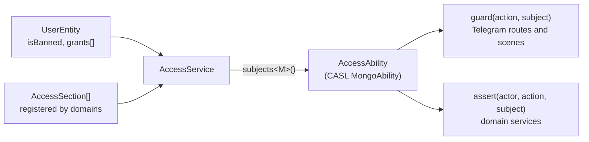

# Access

This directory decides what a user may do. It turns the grants of a user into a CASL ability, and every other domain asks it before it acts: the Telegram transport through guards, the domain services through `assert`. It does not know any feature domain; a domain registers its own grants here.

## Model



| Term                | What it is                                                                                                                                     |
| ------------------- | ---------------------------------------------------------------------------------------------------------------------------------------------- |
| Grant               | A named permission, such as `ping.use`. It has a localized `title` and a `define(rules, user)` that adds CASL rules for the user who holds it. |
| Section             | A group of grants of one domain, with a localized `title`. The invite form shows the grants section by section.                                |
| Subject             | A name that rules talk about, such as `Invite` or `Ping`. Each domain declares its subjects in its own interface, such as `InvitesSubjects`.   |
| Action              | `manage`, `create`, `read`, `update`, `delete` or `use`. `manage` matches every action, and the subject `all` matches every subject.           |
| `UserEntity.grants` | The names of the grants the user holds. Only the invites domain adds names; an operator can change them in MongoDB.                            |

The `admin` grant is registered by this domain and gives `manage all`.

## From grants to an ability

**Problem.** The user document stores only grant names, such as `["ping.use"]`. The rules behind a name belong to the domain that registered it, and a rule can depend on the user, such as "the reports that this user created".

**Idea.** The names stay in MongoDB, and the rules stay in code. On the first question about a user, the service runs `define` of every grant the user holds and builds one CASL ability from the result.

**Walk-through.**

1. On start, every domain plugin calls `access.register(section)`. The service keeps the sections in order for the invite form, and the grants in a map by name. A second section or grant with the same name stops the start.
2. A call of `can`, `assert`, `accessibleBy` or a guard asks for the ability of the user object.
3. For a user without a ban, the service creates one `AbilityBuilder` and calls `define(builder, user)` of every grant in `user.grants` and in the [default grants](#default-grants). Each grant adds its `can` and `cannot` rules to the same builder. A banned user gets no rules at all.
4. The service builds the ability and keeps it in a `WeakMap` by the user object.

**Edge cases.** The update handler loads the user once per update, so one update builds one ability. A user whose grants changed gets a new ability on the next update, because the next update loads a new user object. A grant name that no domain registers any more is skipped, so a removed feature does not break the users who still hold its grant. `subjects<M>()` returns the same object for every domain: the type parameter only narrows what the compiler accepts, and the ability itself covers every subject.

## Bans and grants

`isBanned` is not a grant. It is the gate in front of the bot: a banned user reaches only the deep links registered with `allowBanned`, such as an invite link. A banned user also gets an empty ability, even when the user still holds grants: a write on behalf of a banned user throws `ForbiddenError`, and a read through `accessibleBy` returns nothing. Lifting the ban keeps the grants the user had before.

## Default grants

**Problem.** An open bot gives every user some grants, such as `poker.create`, without an invite. Writing them into every user document would leave the old users without a grant added later, and a grant removed from the defaults would stay with everybody who came before.

**Idea.** The default grants are not stored in the users. `access-default-grants.ts` registers the setting `access.defaultGrants`, and `AccessService` adds its value to the grants of every user without a ban when it builds the ability. An admin picks the grants in `/settings`, see [Settings](../settings/README.md).

**Walk-through.**

1. On start, `access-default-grants.ts` registers the setting with every registered grant except `admin` as an option, and hands `AccessService.useDefaultGrants` a function that reads the setting.
2. An update loads the user and asks a guard. The service builds the ability from `user.grants` together with the default grants, so the new defaults apply from the next update of every user.
3. `admin` never comes from the defaults: the menu does not offer it, and the service drops it when it reads the setting.

**Edge cases.** A banned user gets no default grants, like no other grant. `holds` looks only at `user.grants`, so a user cannot hand a default grant to somebody else through an invite and make it permanent. A grant that a deploy removed falls out of the setting when the setting is read.

## Guard, accessibleBy and assert

All three answer from the same ability, at different boundaries.

| Boundary                   | Call                                                                | On refusal                                                                                                                      |
| -------------------------- | ------------------------------------------------------------------- | ------------------------------------------------------------------------------------------------------------------------------- |
| Telegram entry point       | `access.guard(action, "Report")`                                    | The command leaves the menu and answers like an unknown message; a button answers `telegram:forbidden`; a scene does not start. |
| Service method that reads  | `access.accessibleBy(actor, action, "Report")` in the MongoDB query | The query returns only the documents the user may see, and nothing when the user has no rule for the subject.                   |
| Service method that writes | `access.assert(actor, action, subject("Report", report))`           | CASL throws `ForbiddenError`; the update ends with an error reply.                                                              |

A guard only shapes what the user can reach in the chat, so it checks the subject name: "may this user do the action on some reports". The service checks again, so the business logic stays safe when it is called from somewhere other than the bot, and it checks the documents themselves.

Never check a loaded document against the subject name. With a string, CASL answers whether the user may act on at least one document of the subject and ignores the conditions of the rules, so `can("update", "Report", { ownerId: user._id })` would let the user update every report. Load the document first and tag it with `subject("Report", report)` from `@casl/ability`. A new document is checked the same way, with `subject` around the data it is going to have.

For a list, put `accessibleBy` into the query. It takes the rules of the user for the action and the subject and turns them into a MongoDB query: `{}` for an unconditional rule, the conditions for conditional ones joined with `$or`, a `cannot` rule as `$nor` joined with `$and`, and `{ $expr: { $eq: [0, 1] } }`, which matches nothing, when the user has no rule. So the page and the count include only the documents the user may see. It is a port of `accessibleBy` from `@casl/mongoose`, which supports the plain MongoDB driver but imports `mongoose` and needs it as a peer dependency; for a 15-line helper on top of `rulesToCondition` from `@casl/ability/extra`, the project keeps its own copy instead of a second MongoDB driver. Combine it with other conditions through `$and`, never by spreading it into another object, or a key such as `$or` can overwrite the restriction.

`holds(user, grant)` answers a different question: whether the user may hand a grant to somebody else. It does not look at rules. It is true when the user is not banned and holds the grant name itself or `admin`. The invite form offers only these grants, and `InvitesService.create` checks them again, so a user cannot grant more than the user has.

## Adding a permission to a domain

1. Declare the domain's subjects next to its entity, and take a typed view of the access service with them. Every call through the view checks the subject names and the fields of the rule conditions; there is no global registry of subjects:

    ```ts
    export interface ReportsSubjects {
        Report: ReportEntity;
    }

    const access = fastify
        .getDecorator<AccessService>("accessService")
        .subjects<ReportsSubjects>();
    ```

2. Register one section with the domain's grants in the domain's plugin, with the titles in `<domain>-locales.ts`:

    ```ts
    access.register({
        name: "reports",
        title: (t) => t("reports:section"),
        grants: [
            {
                name: "reports.read",
                title: (t) => t("reports:readGrant"),
                define: ({ can }) => {
                    can("read", "Report");
                },
            },
        ],
    });
    ```

3. Put `guard: access.guard("read", "Report")` on every command, deep link, scene, scene button and scene input that needs it.
4. Give the service the typed view as its dependency. Read through `access.accessibleBy(actor, "read", "Report")` and check every write with `access.assert(actor, "update", subject("Report", report))` on the loaded document. `InvitesService` is the reference.

The new grant shows up in the invite form at once. `define` gets the user, so a rule can depend on the user's own data, for example `can("update", "Report", { ownerId: user._id })`.

## Files

| File                | Owns                                                                                                                                               |
| ------------------- | -------------------------------------------------------------------------------------------------------------------------------------------------- |
| `access-service.ts` | The grant catalog, the ability of a user, the typed view `subjects<M>()` with `can`, `assert`, `accessibleBy`, `guard`, `holds`, the `admin` grant |
| `access-locales.ts` | The titles of the access section and of the `admin` grant                                                                                          |
