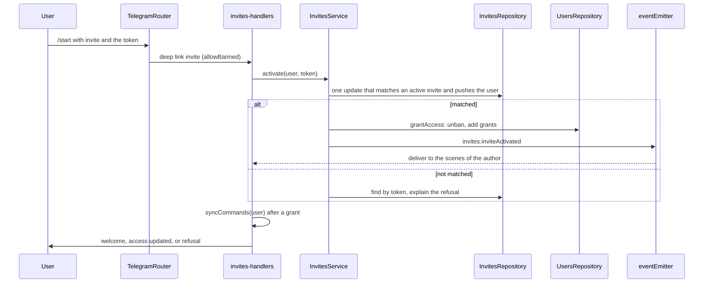
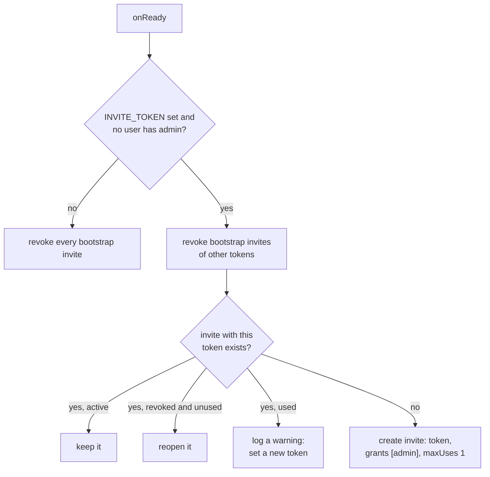

# Invites

This directory lets people into the bot. An invite is a link `https://t.me/<bot>?start=invite_<token>`, a deep link named `invite`, that unbans the users who open it and gives them a set of grants. Admins create and watch invites in the chat with `/invites`; the first admin comes from `INVITE_TOKEN`.

## An invite

| Field         | Meaning                                                                                                                  |
| ------------- | ------------------------------------------------------------------------------------------------------------------------ |
| `token`       | 16 random bytes in base64url, 22 characters, unique. With the `invite_` prefix it fits the 64 characters of a deep link. |
| `createdBy`   | The admin who created it. A bootstrap invite has none.                                                                   |
| `grants`      | The grants every user of the invite gets.                                                                                |
| `maxUses`     | How many different users can use it. Empty means no limit.                                                               |
| `expiresAt`   | When it stops working. Empty means never.                                                                                |
| `revokedAt`   | When an admin revoked it.                                                                                                |
| `activations` | One entry per user who used it, with the time.                                                                           |

The status is derived, never stored: `revoked` when `revokedAt` is set, then `expired` when `expiresAt` is past, then `full` when `activations` reached `maxUses`, otherwise `active`. `readInviteStatus` in `invite-entity.ts` and the `$expr` in `invites-repository.ts` are the two places that compute it, the second one inside MongoDB.

## Using an invite

The activation is one atomic update: the filter checks the status and that the user is not in `activations` yet, and the same update pushes the user. Two users who race for the last place of an invite cannot both get it. The grants are written in a second update, so a failure between the two leaves the place taken and the user without grants; the user repairs it by opening the link again.

| Result                       | When                                                          | Reply                                                          |
| ---------------------------- | ------------------------------------------------------------- | -------------------------------------------------------------- |
| `activated`                  | The atomic update matched                                     | `telegram:welcome` to a banned user, `accessUpdated` to others |
| `alreadyActivated`           | The user is in `activations` and the invite is active or full | The same; the grants are given again                           |
| `notFound`                   | No invite has the token                                       | Nothing to a banned user, `inviteNotFound` to others           |
| `expired`, `revoked`, `full` | The invite exists and cannot be used by this user             | `inviteUnavailable`                                            |

A user who is already in the bot can open a link too: the invite adds its grants to the grants the user has. Grants only grow through invites; removing one is a change in MongoDB for now. `alreadyActivated` gives the grants again only while the invite still works, so revoking or letting an invite expire stops its old users from getting their grants back through it.

## Bootstrap

`INVITE_TOKEN` creates the first admin. On every start, `InvitesService.bootstrap` runs in `onReady`:

A bootstrap invite is an invite without `createdBy`. So the token works once, for the first user, while no admin exists; a changed or removed token, or an admin from any source, closes every older bootstrap invite. A token that comes back before anybody used it reopens its invite; a token that was used stays closed, and the server logs a warning on every start until `INVITE_TOKEN` changes. Nothing makes the check and the insert atomic: two instances that start at the same moment against a database without an admin can both try to insert, and the unique index on `token` stops the second one.

## Scenes

| Scene            | Started by            | Key       | TTL    | Guard           | Shows                                                                                              |
| ---------------- | --------------------- | --------- | ------ | --------------- | -------------------------------------------------------------------------------------------------- |
| `invites.list`   | `/invites`            | `list`    | 1 h    | `read Invite`   | Five invites per page, active first; a button opens each one; `➕ New invite` with `create Invite` |
| `invites.form`   | `➕ New invite`       | none      | 30 min | `create Invite` | A blocking form: grants by section with pages, user limit, valid days                              |
| `invites.invite` | the list, or the form | invite id | 24 h   | `read Invite`   | The link, status, uses, expiry, grants; the users who came; revoke with `update Invite`            |

The form keeps the draft in its own state and writes nothing until `✅ Create invite`. It offers only the grants the admin holds, and `InvitesService.create` checks the same rule again. The limit and the other number of days are scene inputs built from `numberStep`; `/skip` removes the limit.

The invite and the list redraw by themselves when somebody uses an invite: `invites.inviteActivated` carries the invite id and the author, and the handler delivers both scenes of the author. `🔄 Refresh` redraws them on demand. All slots are rich messages, and every callback button stays in the inline keyboard, because the scene engine does not see buttons inside rich blocks yet (`docs/backlog/rich-message-block-buttons-not-recorded.md`).

## Files

| File                                                               | Owns                                                                                     |
| ------------------------------------------------------------------ | ---------------------------------------------------------------------------------------- |
| `invite-entity.ts`                                                 | The invite document and its status                                                       |
| `invites-repository.ts`                                            | MongoDB access: the atomic activation, revocation, bootstrap revocation, the sorted page |
| `invites-service.ts`                                               | The rules: who can create, read and revoke, activation and its refusals, bootstrap       |
| `invites-handlers.ts`                                              | The Telegram side: the deep link, `/invites`, the scenes, the delivery of the event      |
| `invites-list-scene.ts`, `invite-form-scene.ts`, `invite-scene.ts` | The three scenes                                                                         |
| `invite-format.ts`                                                 | Shared view helpers of the scenes: status labels, dates, table cells                     |
| `invites-events.ts`, `invites-errors.ts`, `invites-locales.ts`     | Events, errors, texts                                                                    |
