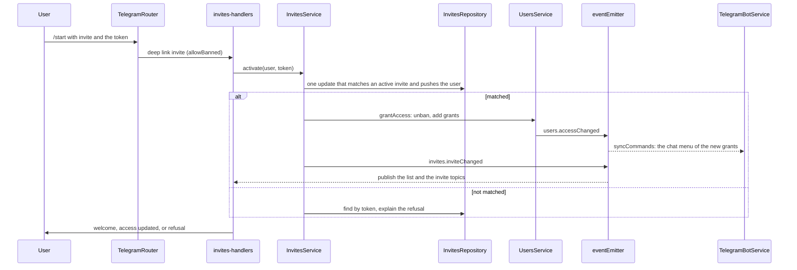
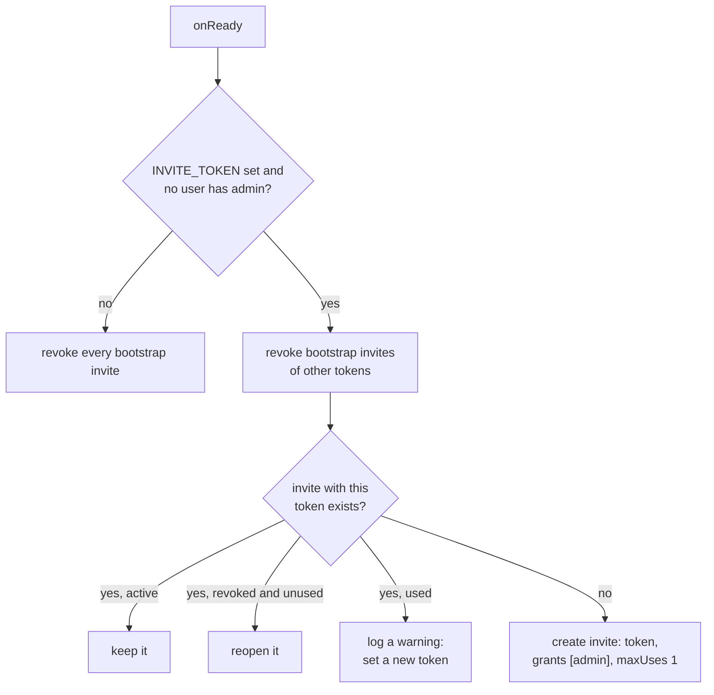

# Invites

This directory lets people into the bot. An invite is a link `https://t.me/<bot>?start=invite_<token>`, a deep link named `invite`, that unbans the users who open it and gives them a set of grants. Admins create and watch invites in the chat with `/invites`; the first admin comes from `INVITE_TOKEN`.

## An invite

| Field         | Meaning                                                                                                                  |
| ------------- | ------------------------------------------------------------------------------------------------------------------------ |
| `token`       | 16 random bytes in base64url, 22 characters, unique. With the `invite_` prefix it fits the 64 characters of a deep link. |
| `createdBy`   | The admin who created it. A bootstrap invite has none.                                                                   |
| `grants`      | The grants every user of the invite gets.                                                                                |
| `maxUses`     | How many different users can use it. Empty means no limit.                                                               |
| `expiresAt`   | When it stops working. Empty means never.                                                                                |
| `revokedAt`   | When an admin revoked it.                                                                                                |
| `activations` | One entry per user who used it, with the time.                                                                           |

The status is derived, never stored: `revoked` when `revokedAt` is set, then `expired` when `expiresAt` is past, then `full` when `activations` reached `maxUses`, otherwise `active`. `readInviteStatus` in `invite-entity.ts` and the `$expr` in `invites-repository.ts` are the two places that compute it, the second one inside MongoDB.

## Using an invite

The activation is one atomic update: the filter checks the status and that the user is not in `activations` yet, and the same update pushes the user. Two users who race for the last place of an invite cannot both get it. The grants are written in a second update, so a failure between the two leaves the place taken and the user without grants; the user repairs it by opening the link again.

| Result                       | When                                                          | Reply                                                          |
| ---------------------------- | ------------------------------------------------------------- | -------------------------------------------------------------- |
| `activated`                  | The atomic update matched                                     | `telegram:welcome` to a banned user, `accessUpdated` to others |
| `alreadyActivated`           | The user is in `activations` and the invite is active or full | The same; the grants are given again                           |
| `notFound`                   | No invite has the token                                       | Nothing to a banned user, `inviteNotFound` to others           |
| `expired`, `revoked`, `full` | The invite exists and cannot be used by this user             | `inviteUnavailable`                                            |

A user who is already in the bot can open a link too: the invite adds its grants to the grants the user has. Grants only grow through invites; removing one is a change in MongoDB for now. `alreadyActivated` gives the grants again only while the invite still works, so revoking or letting an invite expire stops its old users from getting their grants back through it.

## Bootstrap

`INVITE_TOKEN` creates the first admin. On every start, `InvitesService.bootstrap` runs in `onReady`:

A bootstrap invite is an invite without `createdBy`. So the token works once, for the first user, while no admin exists; a changed or removed token, or an admin from any source, closes every older bootstrap invite. A token that comes back before anybody used it reopens its invite; a token that was used stays closed, and the server logs a warning on every start until `INVITE_TOKEN` changes. Nothing makes the check and the insert atomic: two instances that start at the same moment against a database without an admin can both try to insert, and the unique index on `token` stops the second one.

## Scene

`/invites` starts one scene, `invites`, with the key `invites`, a TTL of 24 h and the guard `read Invite`. All its screens share one message: a button changes `screen` in the state, and the slot redraws the same message. A second `/invites` shows the scene again on the screen where the admin left it.

| Screen     | Shows                                                                                              | Leads to                                   |
| ---------- | -------------------------------------------------------------------------------------------------- | ------------------------------------------ |
| `list`     | Five invites per page, active first; a button opens each one; `➕ New invite` with `create Invite` | `invite`, `form`                           |
| `invite`   | Status, uses, expiry, grants; `📋 Copy link` while active; revoke with `update Invite`             | `users`, `‹ Back` to `list`                |
| `users`    | The users who came, ten per page                                                                   | `‹ Back` to `invite`                       |
| `form`     | The draft: grants, user limit, valid days; `✅ Create invite`                                      | `sections`, `validFor`, `invite`, `‹ Back` |
| `sections` | The sections that hold grants the admin has, with pages                                            | `section`, `‹ Back` to `form`              |
| `section`  | The grants of one section as checkboxes, with pages                                                | `‹ Back` to `sections`                     |
| `validFor` | 1, 7 or 30 days, another number, or no expiry                                                      | `form`                                     |

The form keeps the draft in the scene state and writes nothing until `✅ Create invite`, which opens the new invite on the same message. It offers only the grants the admin holds, and `InvitesService.create` checks the same rule again. The buttons and inputs of the form carry the guard `create Invite`, so a user who can only read invites never reaches it. The limit and the other number of days are scene inputs built from `numberStep`; `/skip` removes the limit. The form does not block other scenes.

The scene redraws by itself when an invite changes. The scene watches `invites` on the list and `invites.invite:<id>` on the invite and its users, and nothing on the form. `InvitesService` emits `invites.inviteChanged` with the invite id after it creates, activates or revokes an invite, and the handler publishes both topics, so every admin who looks at the list or at that invite sees the change. The bootstrap on start emits nothing. `🔄 Refresh` redraws the scene on demand. The slot is a compact text message in HTML mode: the helpers in `telegram-html.ts` escape the text, show dates as `<tg-time>`, so each client shows them in its own time zone, and mention users by id. The link is not printed; the `📋 Copy link` button copies it.

## Files

| File                                                                  | Owns                                                                                                |
| --------------------------------------------------------------------- | --------------------------------------------------------------------------------------------------- |
| `invite-entity.ts`                                                    | The invite document and its status                                                                  |
| `invites-repository.ts`                                               | MongoDB access: the atomic activation, revocation, bootstrap revocation, the sorted page            |
| `invites-service.ts`                                                  | The rules: who can create, read and revoke, activation and its refusals, bootstrap                  |
| `invites-handlers.ts`                                                 | The Telegram side: the deep link, `/invites`, the scene, the publish of the event                   |
| `invites-scene.ts`                                                    | The scene: its buttons, inputs and topics, and which screen renders                                 |
| `invites-schemas.ts`                                                  | The state and button schemas of the scene and the view that every screen renders from               |
| `invites-list-screen.ts`, `invite-screen.ts`, `invite-form-screen.ts` | The screens: the list; an invite and its users; the form with its sections and expiry               |
| `invite-format.ts`                                                    | View helpers of the screens: status labels, uses, grants, HTML lines, the message with its keyboard |
| `invites-events.ts`, `invites-errors.ts`, `invites-locales.ts`        | Events, errors, texts                                                                               |
