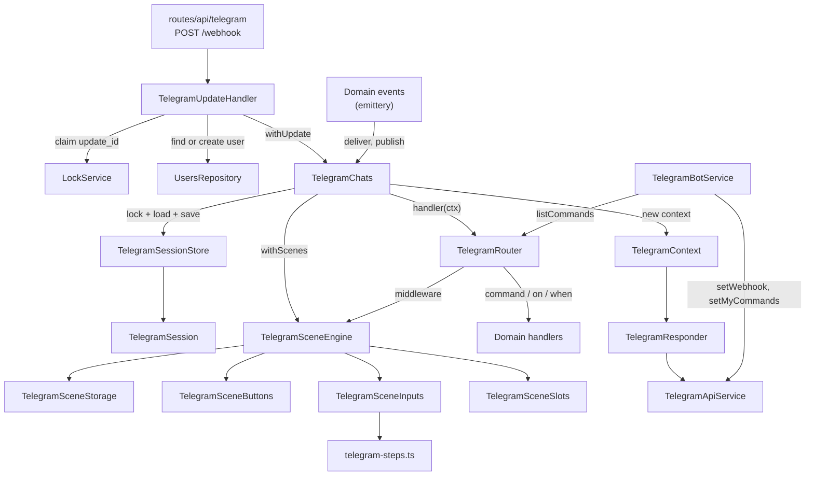
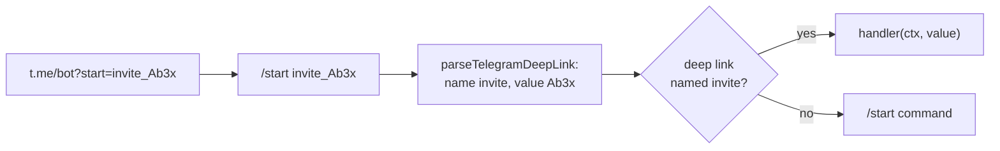
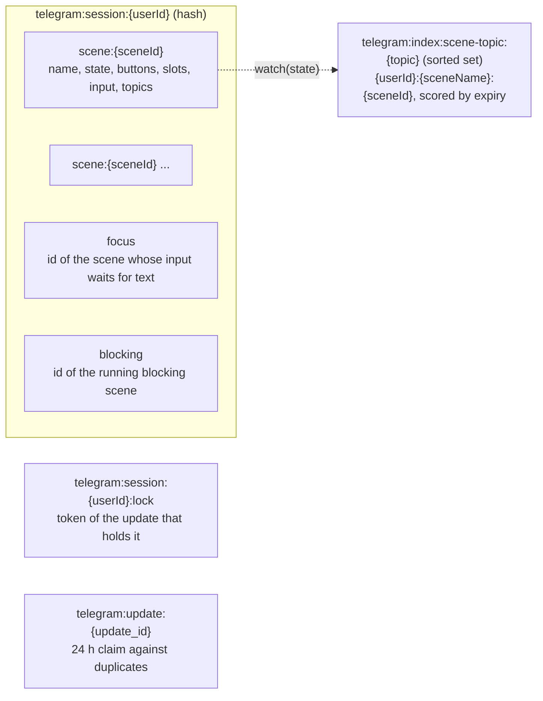
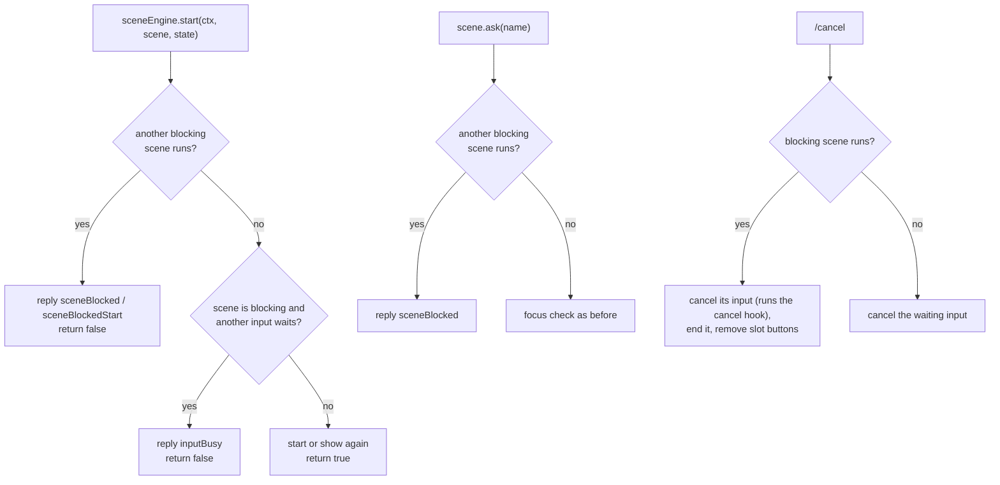
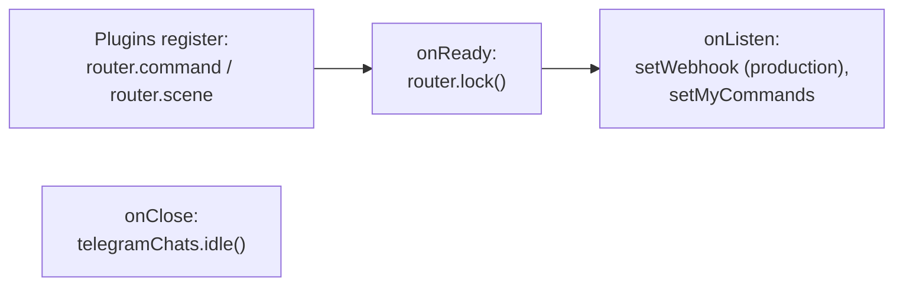

# Telegram

This directory is the Telegram transport and the scene engine of the bot. It turns a webhook request into a call of a command, a route or a scene, keeps the per-user state in Valkey, and draws the scene messages. It does not import feature domains: a domain registers its commands and scenes through `TelegramRouter`.

The rules for writing scenes, inputs, buttons and slots live in the root `AGENTS.md`. This file explains how the pieces fit together and why they exist.

## Map

## An incoming update

`TelegramUpdateHandler` turns every expected failure into a typed error from `telegram-errors.ts` and a result label of `telegram_updates_total`. For a request with a valid secret token the route always answers `200`, so Telegram does not retry an update that failed in the bot.

## An update for other users

Some data belongs to several users at once: a shared entity in a domain repository. Every user who works with it has their own scene instance that shows it. When one user changes the entity, the scenes of the other users must redraw. Nobody writes to the sessions of other users directly: the change goes through a domain event and then a publish or a delivery.

### Publish to the scenes that watch a topic

A topic is a name of the data that a scene shows, chosen by the domain and prefixed with it, such as `invites` or `invites.invite:<id>`. A scene declares the topics it shows now with `watch(state)`, so the topics follow the state: a scene that leaves a screen stops watching its topics at the next save. The domain does not need to know who looks at the data: it calls `telegramChats.publish(topics)` after the change.

The engine keeps the index when it saves a scene. `TelegramSceneStorage.save` calls `watch` on the state, indexes the scene under every topic until the scene expires, and removes it from the topics it no longer watches. Ending a scene or dropping an outdated record removes it from all its topics. `TelegramSessionStore` keeps one sorted set per index, `telegram:index:<name>`, with `<userId>:<entry>` members scored by the time they expire, and writes it in the same Lua call as the session hash, under the same lock condition. A member expires with its scene: reads skip the members whose time has passed, every write to a set removes them, and the set itself expires with its last member. A redraw from `publish` saves the scene, so it extends the TTL of the scene like a button press.

### Deliver to known users

`targets` pairs every user id with the scene key, which is the entity id. Use `deliver` when the domain knows the users, such as the players of a table, or when the scene must change its state or send a notification: without `handle` the scene only redraws its slots from the repository; with `handle` it can also change its state or send a notification.

## Deep links

A link into the bot can only send `/start <payload>`: Telegram has no link that runs another command, and the payload is at most 64 characters of `A-Z`, `a-z`, `0-9`, `_` and `-`. So the payload names its handler: `<name>_<value>`, where the name is `a-z0-9` and the value is everything after the first `_`, such as `invite_Ab3x_9-k` or `poker_6ad0b3`.

A domain registers its link with `router.deepLink(name, handler, options)`; a name is registered once, like a command. `TelegramBotService.resolveDeepLinkUrl({ name, value })` builds the URL and throws when the payload does not fit Telegram's limits, so the format lives in `telegram-deep-links.ts` and nowhere else. A payload without a known name falls through to the `/start` command, and a banned user gets only the links registered with `allowBanned`.

## Access

A guard is a `(user) => boolean` from `telegram-guard.ts`. The transport knows only this type; a domain builds the guard from its CASL rules with `accessService.guard(action, subject)`. The engine checks the guard at every place where the user acts, so a user who loses a grant loses the running scenes at once, without a cleanup.

| Guard on              | Checked                                            | When the guard refuses                                                          |
| --------------------- | -------------------------------------------------- | ------------------------------------------------------------------------------- |
| command, `on`, `when` | while the router looks for a route                 | the route does not match, the user gets `unknown`                               |
| deep link             | while the router looks for a route                 | the `/start` command answers                                                    |
| scene                 | `start`, button press, input, `deliver`, `publish` | `start` returns `false`, a press gets `forbidden`, `deliver` and `publish` skip |
| scene button          | button press                                       | the callback gets `forbidden`, the handler does not run                         |
| scene input           | `ask`, input text, input button                    | `ask` replies `forbidden`, the text goes to the routes                          |

The guard of a command also builds the command menu of the chat. `TelegramBotService.syncCommands` runs on every update of a user with access, keeps a hash of the last menu of the chat in Valkey, and calls `setMyCommands` with the chat scope only when the menu changes: after a new grant, a language change or a deploy that adds a command.

`isBanned` is not a guard: it is the gate before the router. A banned user gets only the deep links registered with `allowBanned`, such as an invite link.

## Abstractions

| File                                                               | Owns                                                                     | Why it exists                                                                                                                                                                                                                                                              |
| ------------------------------------------------------------------ | ------------------------------------------------------------------------ | -------------------------------------------------------------------------------------------------------------------------------------------------------------------------------------------------------------------------------------------------------------------------- |
| `telegram-update-handler.ts`                                       | One webhook update from start to end                                     | Keeps the transport rules (duplicates, private chats, user profile, command menu, error replies) out of the domain code.                                                                                                                                                   |
| `telegram-chats.ts`                                                | Running code inside one user's chat                                      | The only place that builds a `TelegramContext`: for an incoming update and for a delivery to other users. Both need the same session lock, context and scene saving.                                                                                                       |
| `telegram-session-store.ts`, `telegram-session.ts`                 | The session hash `telegram:session:<userId>` and the indexes of sessions | Reads fields lazily, collects changes, and writes them in one atomic call under the session lock. Every field has its own TTL. An index finds the sessions that hold an entry, such as a scene that watches a topic.                                                       |
| `telegram-context.ts`                                              | What a handler can do in the chat                                        | Reply, send, edit, delete, answer a callback. It emits `messageSent`, `messageEdited` and `messageRemoved`, so the engine can see which message got which buttons without the handlers telling it.                                                                         |
| `telegram-responder.ts`                                            | Telegram API calls for one chat                                          | Works without a session, so the update handler can reply before the context exists (unknown message, error).                                                                                                                                                               |
| `telegram-api-service.ts`                                          | HTTP calls to the Bot API                                                | Plain `fetch` with a timeout, logs and metrics.                                                                                                                                                                                                                            |
| `telegram-router.ts`                                               | Commands, deep links, filters, middlewares                               | Domains register here, each route with an optional guard; deep links by name. The scene engine runs as a middleware before the routes, so a running input gets the text first. A banned user reaches only deep links with `allowBanned`. Registration closes on `onReady`. |
| `telegram-deep-links.ts`                                           | The deep link payload                                                    | Parses and builds `<name>_<value>` and checks Telegram's limits.                                                                                                                                                                                                           |
| `telegram-guard.ts`                                                | The guard type                                                           | One predicate for routes, deep links, scenes, buttons and inputs, so the transport does not depend on the access domain.                                                                                                                                                   |
| `telegram-pagination.ts`                                           | Page buttons                                                             | `pageOf` cuts a page out of a list, `pageButtons` builds the `‹ 1/3 ›` row with a disabled counter. Scenes and `choiceStep` share it.                                                                                                                                      |
| `telegram-scene.ts`                                                | The scene definition API                                                 | `defineScene` turns a typed definition into an erased `TelegramScene` that the engine stores by name.                                                                                                                                                                      |
| `telegram-scene-engine.ts`                                         | The life of scene instances                                              | Starts, finds, ends scenes; routes button presses and input text; tracks which instances an update touched, renders their slots after success and saves them always.                                                                                                       |
| `telegram-scene-storage.ts`                                        | Scene records in the session                                             | Ids, keyed scenes, the input focus, the blocking scene, TTL and `maxAge`, the topics a scene watches. One storage object per session.                                                                                                                                      |
| `telegram-scene-buttons.ts`                                        | Button values of an instance                                             | `callback_data` carries only `<sceneId>:<buttonId>`; the values stay in the record. Reuses the id of an equal button so an edited message keeps working.                                                                                                                   |
| `telegram-scene-inputs.ts`                                         | Named inputs and their steps                                             | One input waits for text at a time. Applies transitions, tracks the messages to clean up, drops a failed input.                                                                                                                                                            |
| `telegram-scene-slots.ts`                                          | Messages that mirror the state                                           | Renders a slot, compares a hash and edits, replaces or deletes the message. Handlers only change the state.                                                                                                                                                                |
| `telegram-steps.ts`                                                | Reusable steps                                                           | `textStep`, `numberStep`, `dateStep`, `choiceStep`.                                                                                                                                                                                                                        |
| `telegram-system-handlers.ts`                                      | Built-in commands                                                        | `/start` and `/cancel`.                                                                                                                                                                                                                                                    |
| `telegram-bot-service.ts`                                          | Bot setup                                                                | Sets the webhook once per hour across pods, sets localized commands and the command menu of each chat, resolves the bot username.                                                                                                                                          |
| `telegram-filters.ts`, `telegram-extractors.ts`                    | Reading an `Update`                                                      | Type guards for routes and helpers that read the user, chat, command and type.                                                                                                                                                                                             |
| `telegram-metrics.ts`, `telegram-errors.ts`, `telegram-locales.ts` | Metrics, error types, texts                                              |                                                                                                                                                                                                                                                                            |

The engine splits its work into storage, buttons, inputs and slots. The engine owns the per-update state (which instances were touched), and the other four are services without state that get the instance as an argument. Only `TelegramSceneButtons` keeps the buttons created in the current update, in a `WeakMap` by instance.

## State in Valkey

Every key also has the prefix `smart-assistant:<RESOURCE_NAME>:` from the ioredis client. A keyed scene has an id built from a hash of the scene name and the key, so a second `start` with the same key finds the running scene. A scene without a key gets a random id.

## Blocking scenes

A scene with `blocking: true` keeps the user inside it until it ends, expires or gets `/cancel`. The `blocking` field works like `focus`, but for the whole scene: it points to the scene and expires with it.

Buttons of other running scenes keep working: their `callback_data` names the scene, so a press does not need to wait for the blocking scene. A button handler that starts a scene still gets `false`, and its `scene.ask` gets a refusal, so the input focus belongs to the blocking scene while it runs. A blocking scene without a `key` gets a random id, so `start` reuses the id of the running blocking scene of the same scene definition and shows it again.

## Startup

## Where to start reading

1. `telegram-update-handler.ts`, `handle()`: the whole path of an update.
2. `telegram-chats.ts`, `withContext()`: how a context and the scenes get their session.
3. `telegram-scene-engine.ts`, `handle()` and `withScenes()`: how scenes get updates and when they are saved and drawn.
4. `telegram-chats.test.ts` and `telegram-scene-engine.test.ts`: small complete scenes that show the API in use.
