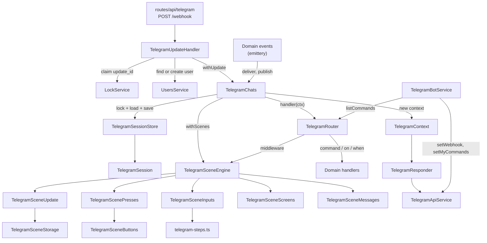
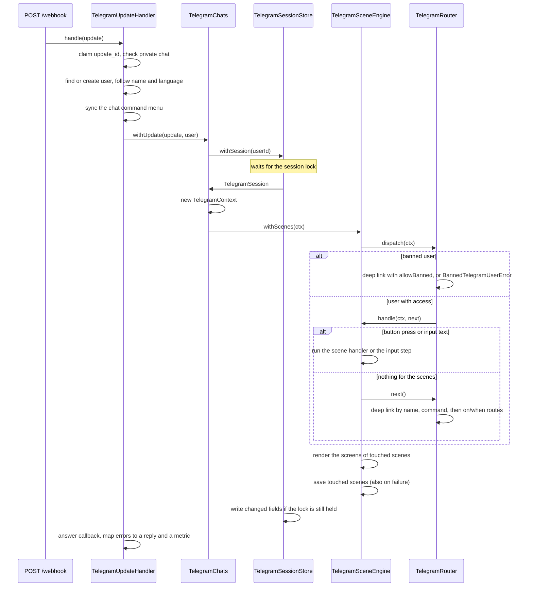
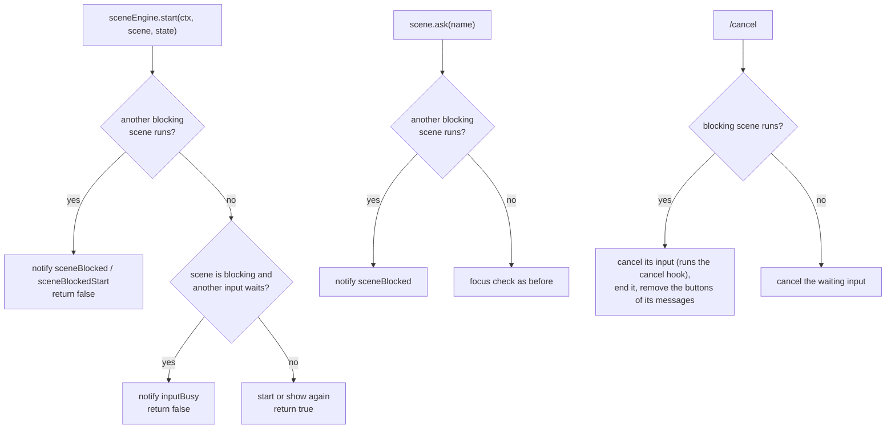
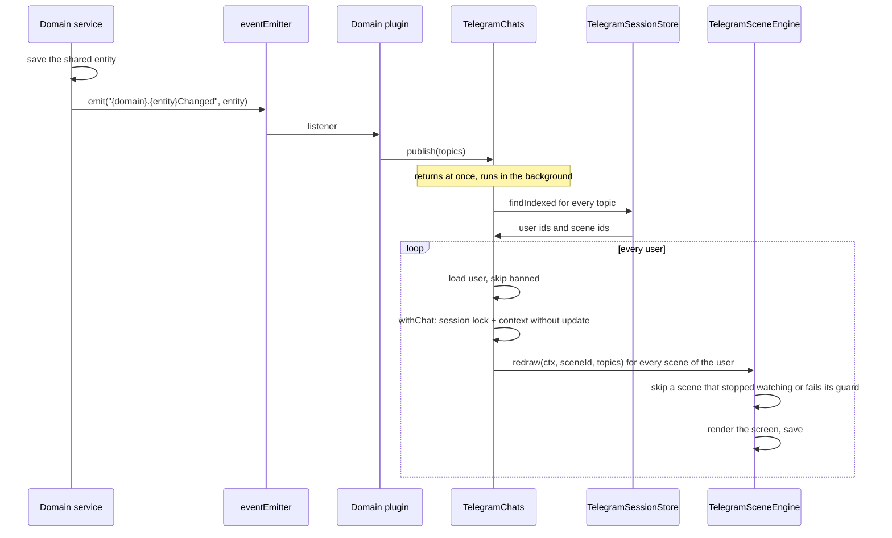
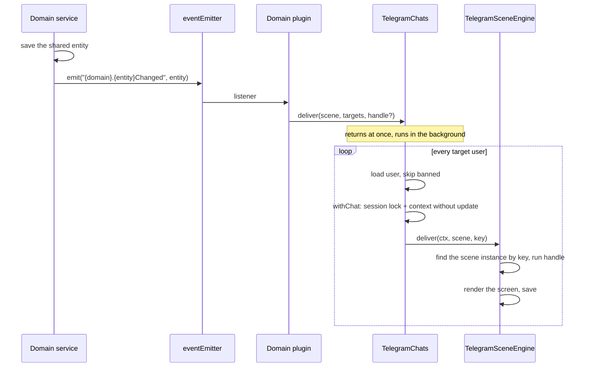
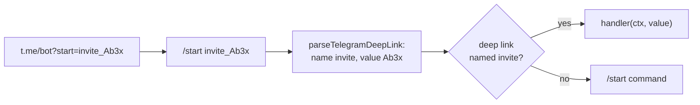

# Telegram

This directory is the Telegram transport and the scene engine of the bot. It turns a webhook request into a call of a command, a route or a scene, keeps the per-user state in Valkey, and draws the scene messages. It does not import feature domains: a domain registers its commands and scenes through `TelegramRouter`.

The first part of this file says how to write bot code in a domain: commands, deep links, scenes with their screens, buttons and inputs. The second part explains how each mechanism works inside and which problem it solves. Every mechanism there follows the same shape: the problem, the idea, the data it keeps, a walk-through, and the edge cases.

- [What Telegram gives us](#what-telegram-gives-us)
- [Writing bot code](#writing-bot-code)
- [Bot UX](#bot-ux)
- [Map](#map)
- [An incoming update](#an-incoming-update)
- [Session and lock](#session-and-lock)
- [Rate limits](#rate-limits)
- [Scene instances](#scene-instances)
- [Buttons](#buttons)
- [Screens and messages](#screens-and-messages)
- [Message handover](#message-handover)
- [Inputs](#inputs)
- [Blocking scenes](#blocking-scenes)
- [Updates for other users](#updates-for-other-users)
- [Deep links](#deep-links)
- [Access and the command menu](#access-and-the-command-menu)
- [Files](#files)

## What Telegram gives us

Most of the code below exists because of these limits of the Bot API:

- The webhook sends the next update of a chat only after the bot answers the current one, so the updates of one user arrive one by one. Updates of different chats arrive in parallel, up to `max_connections` of `setWebhook`, 40 by default. grammY documents the order per chat; the Bot API docs do not. Telegram sends an update again when the bot does not answer `2xx`.
- A message does not say which question it answers. The bot gets free text and must decide itself where it goes.
- `callback_data` of an inline button holds 1 to 64 bytes. A press brings back only this string and the id of the message with the button.
- Old messages with buttons stay in the chat. The user can press a button of a message that the bot drew an hour ago.
- The bot changes a message only by its id. An edit to the same content fails with `message is not modified`, and a text message cannot become a photo.
- The bot can delete a message only during 48 hours after it was sent. In a private chat this covers the messages of the user too.
- A link into the bot can only send `/start <payload>`, with at most 64 characters of `A-Z`, `a-z`, `0-9`, `_` and `-`.
- The command menu is set per chat and per language with `setMyCommands`. A command name holds only `a-z`, `0-9` and `_`, at most 32 characters.
- The Bot API limits the message rate: about 1 message per second in one chat with short bursts, and about 30 messages per second for the whole bot. Any method can answer `429` with `retry_after`, the seconds to wait. Telegram does not publish limits per method.

## Writing bot code

A domain owns its bot code. Its handlers plugin, such as `invites-handlers.ts`, registers commands, deep links and scenes on `TelegramRouter`, and subscribes to its own events. It registers them while the plugin loads: the router locks on `onReady`, and a later registration throws. `invites-handlers.ts` and `invites-scene.ts` are the reference.

### Commands, routes and deep links

- `router.command(name, handler, { guard, description })` registers a command. The name is snake case, such as `new_invite`, and `router.command` rejects any other name. A command with a `description` shows in the menu of every chat whose user passes its `guard`.
- `router.on(filter, handler)` and `router.when(predicate, handler)` match other updates, such as a photo. The router tries a deep link, then a command, then these routes in the order of registration.
- `router.deepLink(name, handler, { guard, allowBanned })` handles a link into the bot. Build its URL with `telegramBotService.resolveDeepLinkUrl({ name, value })`, never by hand. See [Deep links](#deep-links).
- When a command or a deep link starts a scene or shows it again, the engine deletes the message of the command after the update, so the chat keeps only the scene. A command that starts no scene stays in the chat. See [Scene instances](#scene-instances).
- Send every user-facing text through `ctx.t`. A domain keeps its texts in `<domain>-locales.ts` for `en`, `uk` and `ru`, declares its namespace in `ResourceNamespaceMap`, and registers it with `I18nService.addLocales`.
- Log update ids, types and outcomes, never message text, callback data or tokens: `/start <token>` arrives as message text.

### A scene

Build every interaction that keeps state between updates as a scene. A scene keeps the user's view of the data, such as the id of an entity or the current page. The data itself stays in the domain repository, because other users share it and a scene record can expire or be dropped after a deploy.

```ts
const reportStateSchema = Type.Object({ reportId: Type.String() });

export function createReportScene(
    reportsService: ReportsService,
    access: AccessControl<ReportsSubjects>,
) {
    return defineScene({
        name: "report",
        state: reportStateSchema,
        ttl: 24 * 60 * 60 * 1000,
        guard: access.guard("read", "Report"),
        key: (state) => state.reportId,
        watch: (state) => [`reports.report:${state.reportId}`],
        root: { name: "report", params: {} },
        screens: {
            report: {
                params: Type.Object({}),
                render: async (ctx, scene) => {
                    const report = await reportsService.find(
                        ctx.user,
                        scene.state.reportId,
                    );

                    return [
                        {
                            kind: "text",
                            text: report.title,
                            keyboard: [
                                [
                                    scene.button(
                                        ctx.t("reports:rename"),
                                        "rename",
                                        null,
                                    ),
                                    scene.screenButton(
                                        ctx.t("reports:history"),
                                        "history",
                                        { page: 0 },
                                    ),
                                ],
                            ],
                        },
                    ];
                },
            },
            history: {
                params: Type.Object({ page: Type.Integer({ minimum: 0 }) }),
                render: async (ctx, scene, { page }) => [
                    {
                        kind: "text",
                        text: await reportsService.describeHistory(
                            ctx.user,
                            scene.state.reportId,
                            page,
                        ),
                        keyboard: [[scene.backButton(ctx.t("reports:back"))]],
                    },
                ],
            },
        },
        buttons: {
            rename: {
                value: Type.Null(),
                guard: access.guard("update", "Report"),
                handle: (ctx, scene) => scene.ask("title"),
            },
        },
        inputs: {
            title: {
                payload: Type.Object({ title: Type.String() }),
                guard: access.guard("update", "Report"),
                cleanup: true,
                steps: (step) => [
                    textStep(step, {
                        name: "title",
                        property: "title",
                        prompt: (t) => t("reports:titlePrompt"),
                    }),
                ],
                complete: async (ctx, scene, { title }) => {
                    await reportsService.rename(
                        ctx.user,
                        scene.state.reportId,
                        title,
                    );
                },
            },
        },
    });
}
```

The handlers plugin creates the scene, registers it and starts it:

```ts
const reportScene = createReportScene(reportsService, access);

router.scene(reportScene);
router.deepLink("report", async (ctx, reportId) => {
    await sceneEngine.start(ctx, reportScene, { reportId });
});
events.on("reports.reportChanged", ({ data }) => {
    telegramChats.publish([`reports.report:${data.reportId}`]);
});
```

**The definition.**

- `state` is a TypeBox schema. The engine checks every stored record against it, so a record from an older schema is dropped, not misread. Keep only the fields that outlive a screen in it, such as a draft; the fields of one screen go to the params of that screen.
- `screens` lists what the scene can show. A screen has `params`, a TypeBox object, and `render`, which returns the messages of the screen. A screen without params declares `params: Type.Object({})`. `root` is the screen that a new instance starts on. See [Screens and messages](#screens-and-messages).
- `ttl` is how long the scene lives after its last use. An optional `maxAge` limits its whole life from the start. A scene lives until it calls `scene.end()` or its time runs out, and a user can have many scenes at once.
- `key(state)` makes one instance per business entity, such as the id of the entity. A second `start` with the same key shows the running scene again and keeps its state.
- Create a scene in a factory, `create<Name>Scene(dependencies)`, that receives the services it needs. A handler that starts another scene gets `telegramSceneEngine` from the factory too and calls `sceneEngine.start(ctx, otherScene, state)` from the closure. A handler that replaces its scene with another one calls `scene.handOver(otherScene, state)` and needs no engine.

**Handlers.** A scene handler gets the context and the scene as separate arguments, `(ctx, scene)` or `(ctx, scene, value)`; a step gets `(ctx, input)`. The context only talks to Telegram. The scene object holds `state`, `button`, `ask`, `end` and `handOver`.

**Change the state last.** The engine saves every scene that the update touched, also when a handler fails, so a failed handler keeps the changes it made before the error. Call the domain and check the data first, then change `scene.state`. A failed input step drops the input.

**Buttons.** Create every inline button with `scene.button(text, name, value)` for a handler in `buttons`, or with `input.button(text, value)` inside a step. Never write `callback_data` by hand: the scene keeps the value, and `callback_data` holds only a reference. The buttons of every running scene work at the same time. See [Buttons](#buttons).

**Screens.** Show everything the scene draws as screens. `render` returns an array of `TelegramMessageContent` (`text`, `rich` or `media`), and the engine matches the array to the messages of the scene by position: it edits a message in place, sends the new ones at the end and deletes the rest. A handler only changes the state or the screen; the engine draws the current screen after the update. Never keep a message id in the state. A reply sent in a handler comes before the screen messages. Choose what happens to the messages when the scene ends with `scene.end({ messages: "keep" | "removeButtons" | "delete" })`, or end the scene with `scene.handOver(otherScene, state)`: the other scene takes the messages and edits them in place. Check the `false` that `handOver` returns, as with `start`. See [Screens and messages](#screens-and-messages) and [Message handover](#message-handover).

**Navigation.** `scene.screen` is the current screen, `{ name, params }`; a check of `name` narrows the type of `params`, and a handler may change the params in place. The scene keeps a stack of the previous screens:

- `scene.push(name, params)` opens a screen and keeps the current one in the stack. `scene.screenButton(text, name, params)` does the same as a button, without a handler.
- `scene.back()` returns to the previous screen with its params, or to `root` when the stack is empty. `scene.backButton(text)` is the button for it.
- `scene.replace(name, params)` changes the current screen and keeps the stack, so back skips it: use it after a save that turns a form into the saved entity.
- `scene.reset()` clears the stack and opens `root`.

A screen without params takes no second argument: `scene.push("form")`. Each move cancels the waiting input of the scene and a pending confirmation. A `guard` on a screen hides it: the engine refuses a move to it and shows `root` instead when the user loses the access.

**Confirmation.** Mark a destructive button `confirm: true`. The first press only remembers the button and its value and draws the screen again; the second press of the same button with the same value runs `handle`. Any other button of the scene and any move cancel it. Draw the second label with `scene.isConfirming(name)`, such as `⛔ Sure?`.

**Pagination.** Keep the page in the params of the screen and draw it with `pageOf` and `pageButtons` from `telegram-pagination.ts`. Pagination edits the same message, never sends a new one, and back returns to the page the user left.

**Inputs.** Collect typed answers through a named input: `payload`, `steps` and `complete`, started by `scene.ask(name)`. Reuse `textStep`, `numberStep`, `dateStep` and `choiceStep` from `telegram-steps.ts` before you write a custom step. Only one input of a user waits for text at a time; another `ask` gets a notice that the user must finish or `/cancel` first. `/cancel` cancels the input, not the scene, and runs its optional `cancel` hook; without a hook it replies `telegram:sceneCancelled`. `cleanup: true` deletes the questions and the answers of each step once the step accepts an answer. With `cleanup: true`, `/cancel` also deletes its own message and sends no reply, so the chat looks as it did before the question. See [Inputs](#inputs).

**Blocking scenes.** Mark a scene `blocking: true` with a `title` only when the user must finish it before anything else starts, such as a wizard. While it runs, `sceneEngine.start` refuses every other scene, gives a notice with the titles of both scenes, and returns `false`, so check the result before the handler continues. The buttons of other scenes keep working, but their `ask` gets the same refusal. `/cancel` ends a blocking scene, and the scene itself can end with `scene.handOver` to start the next one. See [Blocking scenes](#blocking-scenes).

**Access.** Put `guard: access.guard(action, subject)` on every command, deep link, scene, scene button and scene input that needs a permission. The guard only shapes the chat; the service still checks every read and write. `plugins/app/access/README.md` explains the model.

### Scenes of other users

Never write to the session of another user. Change the scenes of other users through a domain event:

1. The domain service saves the change and emits `<domain>.<entity>Changed` on `eventEmitter`, narrowed with `fastify.getDecorator<Emittery<<Domain>Events>>("eventEmitter")`. The events of a domain live in `<domain>-events.ts`.
2. The handlers plugin subscribes with `on` and calls one of these:
    - `telegramChats.publish(topics)` when any user may look at the data. The scene declares the topics it shows now with `watch(state)`, and a screen adds its own with `watch(params, state)`, such as `<domain>.<entity>:<id>`.
    - `telegramChats.deliver(scene, targets, handle?)` when the domain knows the users, or when the scene must change its state or send a notification. `targets` are user ids with scene keys. The optional `handle` runs under the user's session lock without an incoming update.
3. Both return at once and run in the background, and the engine draws the screens afterwards. So a handler only changes the state or sends a notification. Tests wait for both with `telegramChats.idle()`.

See [Updates for other users](#updates-for-other-users) for how the engine finds and redraws the scenes.

## Bot UX

- Keep the chat free of service buttons. Mention `/cancel` once, in the first question of an input, instead of a cancel button on every message.
- Stay silent when the user expects no answer or an answer would tell about access: an unknown message or command, a command, button, input or deep link that a guard refuses. Answer every input, every known command and every link the user may use, including a refusal such as a closed room or an expired invite.
- Answer a refused button press in the answer to the callback, not with a message: the notice shows over the chat and leaves no trace in it. `ctx.notify(text)` answers the pending callback of the update, or replies when the update is a message. The engine refuses `ask` and a scene start this way.
- Mention step commands such as `/skip` in the prompt text of the step that accepts them.
- Use inline buttons only when the user picks from a set of options, such as an account or a date. Accept typed text for free-form input.
- Update the existing message for pagination and similar controls instead of sending a new one: show it as a screen and keep the page in its params.
- Name a command in snake case: lowercase Latin letters, digits and underscores, such as `/new_invite`, at most 32 characters.
- The bot works in private chats only. The update handler ignores groups and channels, so do not add group-specific behavior such as reply targets or forum topics.

### Button layout

Every inline keyboard follows the same layout, so a user finds the same kind of button in the same place on every screen.

1. Order the rows from top to bottom: the options to pick from (items, cards, decks), the page row, the main action of the screen, the secondary actions, and the navigation row.
2. Put the navigation row last. `‹ Back` stands on its left. The action that finishes the screen, such as `✅ Create`, `🔒 Close` or `⛔ Revoke`, stands on its right. A screen without `‹ Back` puts its dismiss button, such as `✖️ Hide`, in that row.
3. Put at most two buttons in a row. A grid of options is the exception: up to six cards, or up to three choices of a period.
4. Colour only two kinds of buttons through `style`: the main action gets `primary` or `success`, a destructive action gets `danger`. A client without `style` shows plain buttons, so the text of a button must make sense without the colour.
5. Ask for a destructive action twice: declare its button with `confirm: true`. The second label is short, such as `⛔ Sure?`, so it still fits next to `‹ Back`. Any other button of the scene cancels the confirmation.
6. Name the action on a button and show the values in the text of the message. A form button reads `🃏 Deck`, not `🃏 Deck: Fibonacci`, so two field buttons fit in one row.

## Map



## An incoming update



**Duplicates.** Before anything else, the handler sets `telegram:update:<update_id>` with `SET NX` for one hour. A second delivery of the same update finds the key and ends as `duplicate`. The claim stays after a failure too, so a failed update never runs twice. Telegram keeps an undelivered update for up to 24 hours, so a repeat that comes more than an hour later runs again. Such a repeat needs a webhook that failed to answer for over an hour after the bot handled the update; a claim per update for 24 hours costs more memory than that rare case is worth.

**Errors.** `TelegramUpdateHandler` turns every expected failure into a typed error from `telegram-errors.ts` and a result label of `telegram_updates_total`. A failed Bot API call throws `TelegramApiError` with the method, `error_code`, description and `retry_after`. The handler labels a 403, a user who blocked the bot, as `blocked` and sends no error reply, because that reply would fail the same way. A 429 does not reach the handler: `TelegramApiService` waits and repeats the request, see [Rate limits](#rate-limits). An unexpected error is logged and gets the `telegram:error` reply. An update that lost its session lock or held it too long gets the same reply and the label `lock_lost` or `lock_hold_timeout`. For a request with a valid secret token the route always answers `200`, so Telegram does not send an update again after it failed in the bot.

**New users.** The user lookup is one upsert by the Telegram id through `UsersService.findOrCreateByTelegramId`. A new user starts banned while the setting `users.autoBan` is on, its default; with the setting off, a new user gets the [default grants](../access/README.md#default-grants) at once. When the upsert creates the user, the handler counts `telegram_users_created_total`.

## Session and lock

**Problem.** A scene keeps its state between updates, so the state must live outside the process. An update and a delivery for the same user can run at the same time on two pods, and Telegram can send an update again while the first copy still runs. When both read a scene, change it and write it back, the second write loses the change of the first one.

**Idea.** Every user has one session in Valkey, and only the holder of the session lock reads and writes it. An update collects its changes in memory and writes all of them in one atomic call, and only while it still holds the lock.

**Data.**

```text
telegram:session:42            hash, every field with its own TTL (HPEXPIRE)
    scene:Xk3f9aB1c0dE         the record of one scene instance, JSON
    focus                      id of the scene whose input waits for text
    blocking                   id of the running blocking scene
telegram:session:42:lock       token of the update that holds the session
telegram:index:<name>          sorted sets, see "Updates for other users"
```

A hash keeps all the state of a user under one key, so one Lua call writes it atomically. A field TTL lets every scene expire on its own, without a cleanup job. `HPEXPIRE` needs Valkey 9.

**Walk-through.**

1. `TelegramSessionStore.withSession` takes the lock: `SET <session>:lock <token> NX PX 30000`. It tries again every 50 ms until it gets the lock. A wait of more than 1 s logs a warning; `lock_wait_seconds` measures every wait.
2. While the update runs, the lock extends itself every 10 s, so a long update does not lose it. The lock gives the handler an `AbortSignal`, and `TelegramChats` puts it into the scope of the Bot API calls, see [Rate limits](#rate-limits).
3. `TelegramSession.read` loads a field the first time somebody asks for it and keeps it in memory. A handler that touches one scene reads one field.
4. `write`, `remove`, `index` and `unindex` only record the change.
5. At the end, `save` sends every change in one Lua script. The script first compares the lock key with the token of this update. When it differs, the script writes nothing and the update fails with `LockLostError`. Otherwise it runs `HSET` and `HPEXPIRE` for every written field, `HDEL` for every removed field, and updates the index sets.
6. The lock is released with a `DEL` under the same token check.

**Edge cases.** A waiter has no time limit: a limit on the waiter does not stop the holder, it only turns a wait into an error. The holder has the limit instead. After 60 s (`lockMaxHoldMilliseconds`) the lock stops its extension and aborts its signal with `LockHoldTimeoutError`; when an extension finds another token, it aborts the signal with `LockLostError`. Our code is fast, and only the external calls wait: the rate limiter and the Bot API request. Both listen to the signal, so the handler stops and the next update gets the lock after the TTL at most. `lock_hold_seconds` measures every hold.

The session is saved also when the handler throws, so the changes made before the error stay. When the save fails too, the update throws an `AggregateError` with both errors. A pod that stops for longer than the lock TTL loses the lock, and its later save writes nothing. Every write with the bot's own context goes through this lock, also an update for another user, so a delivery and the user's own update never mix.

## Rate limits

**Problem.** Telegram answers `429` when the bot sends too fast, and a bot that ignores `retry_after` gets longer bans. Two kinds of traffic share the limit of the bot: the replies to the user's own updates, and the background deliveries of `publish` and `deliver`. One `publish` can start a delivery for hundreds of users at once. Without a limiter it fills the limit, and the user who presses a button waits behind it. Several pods share one bot token, so a limit in the memory of one pod does not hold.

**Idea.** Every Bot API call takes a token from token buckets in Valkey before the request. A token is taken at the moment of the request, never reserved for the future, so the next token always goes to the call that should get it now. The global bucket splits its rate between two classes: `interactive` for an update and `background` for a delivery. While both classes wait, `interactive` gets 80% and `background` 20%; a class that waits alone gets the whole rate. The limits stay a little under the limits of Telegram, so a `429` means that our numbers are wrong.

**Data.** The prefix of the resource is left out.

```text
rate-limit:telegram:<botId>:chat:42                    hash: tokens, updatedAt (ms)
rate-limit:telegram:<botId>:global                     hash: tokens, updatedAt
rate-limit:telegram:<botId>:global:class:interactive   hash: tokens, updatedAt
rate-limit:telegram:<botId>:global:class:background    hash: tokens, updatedAt
rate-limit:telegram:<botId>:global:waiting:background  sorted set: pod id → expiry time (ms)
rate-limit:telegram:<botId>:commands                   hash: tokens, updatedAt
```

`<botId>` is the number before `:` in `TELEGRAM_BOT_TOKEN`, so every bot has its own buckets. A bucket refills lazily: a Lua script adds `elapsed × rate` tokens, up to the burst, when somebody reads it, and takes the time from `TIME` in Valkey, so all pods agree on the clock. A hash expires 1 s after it would be full again.

`telegram-rate-limits.ts` maps a method to its limits:

| Limit                                    | Rate         | Burst | Methods                                      |
| ---------------------------------------- | ------------ | ----- | -------------------------------------------- |
| `chatMessages`, `chat:<chat_id>`         | 1 per second | 3     | `send*`, `edit*`, `deleteMessage(s)`         |
| `botMessages`, `global` with the classes | 25 per sec.  | 5     | `send*`, `edit*`                             |
| `botCommands`, `commands`                | 5 per second | 5     | `setMyCommands`                              |
| none                                     |              |       | `answerCallbackQuery`, `getMe`, `setWebhook` |

We do not know whether Telegram counts edits in the global limit, so edits take a global token too. Telegram publishes no limit for `setMyCommands`. Every new user and every change of a menu calls it, so a wave of new users would send it in a burst; `botCommands` spreads the burst, and a `429` pauses the bucket for every pod.

**Walk-through.** A user presses a button, the handler changes the screen, and the engine edits its message.

1. `TelegramChats.withContext` runs the handler inside `telegramApiScope` with the signal of the session lock and the class `interactive`. A delivery gets the class `background`. A call outside a session, such as `setMyCommands` before the lock, gets the class `interactive` and its own 60 s timeout signal.
2. `TelegramApiService.call` reads the scope and asks `telegramRateLimitBuckets` for the buckets of `editMessageText`: the chat bucket, then the global one.
3. `RateLimiter.acquire` takes a chat token. When the bucket is empty, the script returns the time to the next token, and the call sleeps and tries again. Calls of one chat seldom compete here: the session lock already runs the updates of a user one by one.
4. For the global bucket the call joins the queue of its class in `RateLimitQueue`, one queue per bucket in the pod. A single loop serves the queues. On every call the script adds the id of the pod to `waiting:<class>` for each class with a waiter in this pod, with an expiry 2 s ahead, and removes it from every other class. A class waits while its set holds an unexpired pod. The rate of a class bucket is `rate × share / sum of the shares of the waiting classes`. The script grants a token to the first class of the pod whose own bucket and the global bucket both have one. The loop releases the first call of that class, or sleeps until the next token, at most 1 s, so its marks stay fresh. When the queues of the pod are empty, the loop makes one last call that removes the pod from every class, and stops.
5. The call sends the request with `AbortSignal.any([signal, timeout])`.
6. On `429` the call records `retry_after`, empties the chat bucket for `retry_after` seconds, so every call of that chat waits, and goes back to step 3. A method without buckets just sleeps `retry_after`. There is no retry limit: the signal of the scope ends the wait.

**Edge cases.**

- The signal aborts a wait and a request with its reason, such as `LockHoldTimeoutError`. The call leaves its queue, and the update ends as `lock_hold_timeout`. A delivery counts as `delivery_failed`.
- A network error or a timeout of the request is not repeated: a repeated `sendMessage` can send the message twice.
- When Valkey fails, the call fails, and so do the session and the lock.
- With several pods the global limit and the shares stay exact, because the buckets and the `waiting:*` sets are shared. A pod only picks which of its own calls to release.
- A call that joins while the loop waits for Valkey wakes the loop, so the next take includes its class at once.
- A class bucket needs a burst above 1. With a burst of 1 the bucket loses every token that the late timer of the loop could not take: in a test at 100 tokens per second, the rate dropped by a fifth.
- A pod that dies leaves its marks for up to 2 s, and the other class keeps its share for that time.

**Metrics.** `telegram_rate_limit_wait_seconds{method, priority}` measures the wait for the tokens; its p95 for `interactive` shows a limit that is too tight. `telegram_api_requests_total{result="rate_limited"}` counts every `429`, and any growth means the numbers are above the real limits. The `error_code` label of `telegram_api_requests_total` keeps the Bot API code of a failed request, so a `400` of `editMessageText`, a message that had to be sent again, stays apart from a `403` of a user who blocked the bot. `telegram_api_retry_after_seconds{method}` shows the `retry_after` values. `result="aborted"` counts the requests that the signal of the scope stopped.

**A new Bot API method.** A method that sends, edits or deletes a message gets a line in `telegramRateLimits` with the limits it counts against. A method without a line has no limits, and only its `429` makes it wait. A new kind of limit is a new `TelegramRateLimit`: its rate, burst, optional `shares`, and `scopeOf`, which turns the params of the call into the key of the bucket or skips the bucket.

## Scene instances

**Problem.** A handler needs a typed state that lives between updates and goes away on its own. A user can have several such states at once, and some of them must exist only once per business entity.

**Idea.** `defineScene` describes a scene. An instance of it is one record in the session, with its own id and TTL. The engine finds the instance again by the id that comes back in a button press or in the `focus` field.

**Data.** One field `scene:<sceneId>` per instance:

```json
{
    "name": "invites",
    "startedAt": 1760500000000,
    "state": { "draft": { "grants": [], "maxUses": 1, "validForDays": null } },
    "screen": { "name": "invite", "params": { "inviteId": "66f1c2…" } },
    "stack": [{ "name": "list", "params": { "page": 2 } }],
    "confirming": { "name": "revoke", "value": "66f1c2…" },
    "buttons": { "nextId": 7, "messages": [] },
    "messages": [{ "messageId": 812, "kind": "text", "hash": "Qm9…" }],
    "topics": ["invites.invite:66f1c2…"]
}
```

**Walk-through.**

1. `sceneEngine.start(ctx, scene, state)` checks the guard of the scene and builds the id. With a `key`, the id is the first 12 characters of `sha256("<scene name>:<key>")` in base64url, so the same key always gives the same id. Without a `key`, the id is 8 random bytes.
2. When a record with this id already exists, `start` does not create a second one. It shows the running scene again: its messages move to the bottom of the chat, and the state and the screen stay as they are.
3. Otherwise the engine creates the record and runs the `start` hook of the scene.
4. Every call that gives a handler the scene object marks the instance as touched in `TelegramSceneUpdate`.
5. After the update, the engine draws the current screen of the touched instances, but only when the handler succeeded. When a command or a deep link started or showed a scene in this update, the engine then deletes the message of the command. It saves the touched instances always.
6. `save` writes the record with a TTL of `min(ttl, startedAt + maxAge - now)`. So `ttl` is the idle time after the last touch, and `maxAge` is the limit from the start. When that value reaches 0, `save` removes the record.

**Edge cases.** A command whose start is refused stays in the chat. The guard of the scene refuses silently, and a command that vanishes without an answer looks like a fault; a blocking scene answers with a notice that needs the command above it. A command whose handler fails stays above the error message too. Only a message with a command counts: a text answer that leads to a `start` stays. The engine reads a record through the current TypeBox schema of the scene. After a deploy that removed the scene or changed the schema of its state, the record does not match. The engine then removes the record and logs `Telegram scene is not registered or its state is outdated`. The user's next press on its buttons gets `buttonExpired`. Business data stays in the domain repository. The state keeps only the view of it, such as an id and a page, so a lost record loses nothing important.

## Buttons

**Problem.** A button must bring the scene, the action and its value back to the bot. `callback_data` holds only 64 bytes, which is too small for an `ObjectId`, an action and a draft. And the user can press a button on an old message after the scene drew a new version of that message.

**Idea.** The value of a button stays in the scene record. `callback_data` is only a reference, `<sceneId>:<buttonId>`, and the record keeps the buttons of each message separately.

**Data.** `buttons` in the scene record:

```json
{
    "nextId": 7,
    "messages": [
        {
            "messageId": 812,
            "buttons": {
                "3": { "kind": "scene", "name": "open", "value": "66f1c2…" },
                "4": { "kind": "scene", "name": "page", "value": 1 }
            }
        }
    ]
}
```

A `scene` button runs a handler from `buttons` of the scene. A `screen` button, `{ "kind": "screen", "screen": { "name": "users", "params": { … } } }`, pushes that screen, and a `back` button returns to the previous one; neither has a handler. An `input` button belongs to one step of an input, see [Inputs](#inputs).

**Walk-through.**

1. A screen or a handler calls `scene.button("Open", "open", id)`. The engine looks for an equal button, the same kind, name and value, in the messages that the scene shows now. When it finds one, it takes its id. Otherwise it takes `nextId` and increments it. One `render` draws all messages of a screen at once, so the engine does not know which message a button is for; an equal button in two messages gets one id, and each message still keeps its own copy.
2. The engine keeps the button in memory as unsent and returns `{ text, callback_data: "Xk3f9aB1c0dE:3" }`.
3. `TelegramContext` sends or edits the message and emits `messageSent` or `messageEdited` with the keyboard.
4. The engine reads the `callback_data` of this scene from the keyboard and writes only those buttons under the id of the message. A button that never reached a message is never stored.
5. A press with `Xk3f9aB1c0dE:3` on message 812 loads the instance `Xk3f9aB1c0dE` and finds button 3 in message 812.
6. The engine checks the value against the schema of the `open` button and checks the guard of the scene and of the button. Then it runs the handler with the stored value. A `screen` button checks the params against the schema of the screen and the guard of the screen instead.

**Why the id is reused.** The engine compares a hash of the content of each message, and the content includes the `callback_data`. When a redraw gives an equal button a new id, the hash changes and the engine calls `editMessageText` for a message that looks the same. With the old id, an unchanged screen costs no API call.

**Edge cases.**

- A message that the scene edited without a button, or deleted, no longer holds that button. A press on it, or on a message of an ended scene, gets `telegram:buttonExpired`.
- A value that no longer matches the schema of its button after a deploy also gets `buttonExpired`. A failed guard gets an empty callback answer, so the press says nothing about the access of the user.
- A press does not need the input focus, so the buttons of every running scene work at the same time.
- A button with `confirm: true` keeps `confirming` in the record after the first press and runs `handle` only on the second press with the same value. Every other press of the scene, a `screen` or `back` button, an `input` button, a button with another value, and every move clear `confirming` first. `publish` and `deliver` redraw the screen and keep it, because the user pressed nothing.

## Screens and messages

**Problem.** A scene shows its state as messages that change: a list with pages, a form. Without help, every handler would keep the message ids, choose between send and edit, avoid `message is not modified`, and clean up after a deleted message. A scene also moves between several views of its data, such as a list, an item and a form, and each view may need more than one message. Without help, every scene keeps the name of its view and the fields of every view in one flat state, resets them by hand on each move, and loses the page of the list when the user comes back. And the bot can only add a message at the bottom of the chat: a message that appears above another one lands below it.

**Idea.** A screen is a name with typed params and a `render` that returns the messages of the screen. The record keeps the current screen and a stack of the previous ones, so back restores a screen with its params. The engine matches the messages of the new screen to the old ones by position, so an edit keeps a message in place and a new message always goes to the end.

**Data.** The scene record keeps:

- `screen`: the current screen, `{ "name": "users", "params": { "inviteId": "66f1c2…", "page": 0 } }`.
- `stack`: the previous screens, the last one on top. The stack has no limit; a scene moves forward with `push` and returns with `back`, so its depth follows the tree of its screens.
- `messages`: per position, the id of the message, its kind (`text`, `rich` or `media`) and a SHA-256 hash of the content that it shows now.
- `confirming`: the button that waits for its second press, see [Buttons](#buttons).

**Walk-through.** The user is on the list of invites on page 2 and opens an invite with two messages.

1. The `screen` button pushes `list` with `{ "page": 2 }` to the stack and makes `invite` the current screen. The move cancels the waiting input of the scene, with `cleanup` of the input, and clears `confirming`.
2. After the update, the engine checks the guard of the current screen and calls its `render`, which returns two messages.
3. Position 0 had the list. The hash differs, so the engine edits that message into the invite.
4. Position 1 had no message, so the engine sends one. It goes to the end of the chat, below position 0.
5. `‹ Back` pops `list` with `{ "page": 2 }`. Position 0 is edited back into page 2 of the list, and the message at position 1 is deleted.

For every position the engine:

1. Does nothing when the hash is the same as before.
2. Otherwise edits the old message. `message is not modified` counts as a success.
3. When the edit is not possible or fails, for example because the user deleted the message, sends a new message and only then deletes the old one. A `media` message is never edited into text; a text message is edited into media only when Telegram accepts it.

Once it sent a new message, it sends every later position again too, and deletes their old messages, so the messages keep the order of the array. Positions past the end of the new array lose their messages. Messages that a handler sends with `ctx.reply` come before the screen messages, because the screen renders at the end of the update.

**Edge cases.**

- When Telegram refuses the new message too, for example because the text is too long, the old message stays with its old content and the update fails.
- A second `start` of a running scene sets `reshow`: the engine skips the hash check and sends every message of the current screen again at the bottom of the chat. The stack stays.
- When the guard of the current screen refuses the user, for example after a lost grant, the engine clears the stack and draws `root`.
- After a deploy, a record whose `screen` or `stack` names a screen that no longer exists, or holds params that no longer match its schema, is dropped like a record with an outdated state.
- When the handler or `render` fails, the state is saved but the screen is not drawn, and the messages stay as they were. The next touch of the scene finds a different hash and draws it.
- When the bot cannot delete a message, for example one older than 48 hours, it removes the keyboard of the message instead.
- `scene.end({ messages })` chooses what happens to the messages: `keep`, `removeButtons` or `delete`.
- A scene without `screens` draws no messages, for example a scene that only asks a question.

## Message handover

**Problem.** A scene that opens another scene, such as a list that opens an item, leaves its own message in the chat, and the other scene sends a new message below it. The chat grows by one message on every open. A handler cannot move the message to the other scene by itself, because it never keeps a message id.

**Idea.** `scene.handOver(otherScene, state)` ends the scene and gives its `messages` to the instance of the other scene. The engine draws the other scene into those messages by position, so the list message becomes the item in place.

**Data.** Only the `messages` of the two records change. Before the handover the list record holds `[{ "messageId": 812, "kind": "text", "hash": "Qm9…" }]`. After it the item record holds `[{ "messageId": 812, "kind": "text", "hash": "" }]`, and the list record is gone. The empty hash never matches the hash of a content, so the render edits the message.

**Walk-through.** The user presses an item in the list.

1. The engine checks the guard of the other scene, then the blocking scene and the waiting input, like `start`. The scene that hands over does not count as a blocker, so a blocking wizard can hand its messages to the scene it built. For the same reason, a blocking scene without a `key` that hands over to its own definition gets a new instance, not itself.
2. The engine cancels the waiting input of the first scene silently, with `cleanup`, and ends it with `keep`. The log `Telegram scene ended` carries `handedOverTo` with the id of the other instance. From now on the first scene neither blocks nor holds an input, so the `start` hook of the other scene can call `ask`.
3. When the instance of the other scene runs already, the engine takes it with its screen and stack. Otherwise it creates the instance and runs its `start` hook.
4. The engine deletes the messages of a running instance, or removes their buttons when the bot cannot delete them. Then it gives the instance the messages of the first scene with empty hashes.
5. After the update, the render edits message 812 into the item. When the kinds do not allow an edit, it sends a new message and deletes the old one. It deletes the extra positions and sends the missing ones at the end.

**Edge cases.**

- When the guard of the other scene or a blocking scene refuses, `handOver` returns `false`, and the first scene keeps its state and its messages. A blocking scene gives the usual notice.
- A handover to the same instance, such as a keyed scene to itself, throws: it is a bug in the caller.
- A scene without messages hands over an empty array, so the other scene sends its messages as after `start`.
- The old buttons of the first scene answer `buttonExpired`: its record is gone, and the edit puts the buttons of the other scene on the message.
- When the `start` hook of the other scene fails, the first scene has already ended. The message keeps its content, and its buttons answer `buttonExpired`.
- When the handler fails after `handOver`, the record of the other scene is saved, but the screen is not drawn. The message keeps the content of the first scene until the next touch of the other scene finds the empty hash and draws it.
- After `handOver`, changes through the `scene` object of the first scene are lost, as after `end`.

## Inputs

**Problem.** A typed message has no reference to a scene. When two scenes wait for text at the same time, the bot cannot know which one the text answers.

**Idea.** Only one input of a user waits for text at a time. The `focus` field of the session points to the scene that holds it. An input is a list of steps with a typed payload, and each step decides which updates it accepts.

**Data.** `input` in the scene record, and `focus` in the session with the same TTL as the scene:

```json
{
    "name": "maxUses",
    "step": "value",
    "history": [],
    "payload": {},
    "messageIds": [901, 902]
}
```

**Walk-through.**

1. A handler calls `scene.ask("maxUses")`. The engine checks the guard of the scene and of the input, and that no other scene holds the focus. Then it writes `input` and runs `enter` of the first step, which usually sends the question.
2. The engine runs as a middleware before the routes. For a message, it loads the instance from `focus`.
3. When the current step `accepts` the update, the step runs `handle` and returns a transition: `next`, `stay`, `goto`, `back`, `cancel` or `complete`. A transition can carry a `patch` for the payload, and `back` follows `history`.
4. After the last step, or on `complete`, the engine decodes the payload with its schema, removes `input` and calls `complete` of the input.
5. A text message that the step does not accept gets the `hint` of the step. A command is never input text: `message("text")` skips commands, so `/cancel` and every other command still reach the routes.

**Edge cases.**

- `cleanup: true` collects the ids of the user's answers and of the bot's messages during a step, and deletes them when the step ends. A cancel adds the message of the `/cancel` command to them and skips the `telegram:sceneCancelled` reply; the `cancel` hook of the input still runs.
- A step that throws drops the whole input and its buttons. The scene stays.
- A second `ask` in the same scene replaces its input. An `ask` while another scene holds the focus gets `telegram:inputBusy`.
- `focus` repairs itself. When it points to a scene that has no input any more, or to an input that a deploy removed, the engine clears it.
- An `input` button is valid only while its step is the current step. Every step change forgets the input buttons of the scene.
- A move to another screen of the scene, `push`, `replace`, `back` or `reset`, cancels its waiting input without a reply and without the `cancel` hook, and `cleanup: true` deletes the question. So `complete` always runs on the screen that asked.

## Blocking scenes

**Problem.** Some flows, such as a wizard, must finish before the user starts anything else.

**Idea.** A scene with `blocking: true` writes its id into the `blocking` field of the session, which expires with the scene. While the field points to a running scene, the engine refuses every other scene start and every other input. The blocking scene itself can still end with `scene.handOver`, which releases the block and starts the other scene.



**Edge cases.** Buttons of other running scenes keep working, because their `callback_data` names the scene. A button handler that starts a scene still gets `false`, and its `scene.ask` gets a refusal. A blocking scene without a `key` gets a random id, so `start` takes the id of the running blocking scene of the same definition and shows it again.

## Updates for other users

**Problem.** Some data belongs to several users at once, such as an invite that every admin can open. Every user who looks at it has their own scene instance. When one user changes the data, the scenes of the other users must redraw. A handler cannot write to their sessions: each session belongs to the holder of its lock.

**Idea.** The change goes through a domain event. The domain plugin then asks `TelegramChats` to run code inside each affected chat, under that user's lock, as if the user had sent an update. The engine renders and saves the scenes there in the usual way.

There are two ways to find the affected scenes.

### Publish to the scenes that watch a topic

A topic is a name of the data that a scene shows, chosen by the domain and prefixed with it, such as `invites` or `invites.invite:<id>`. A scene declares the topics it shows now with `watch(state)`, so the topics follow the state. The domain does not need to know who looks at the data: it calls `telegramChats.publish(topics)` after the change.

**Data.**

```text
telegram:index:scene-topic:invites.invite:66f1c2…     sorted set
    42:invites:Xk3f9aB1c0dE      score 1760586400000   (expiry of the scene)
    77:invites:Pq81LmZ0aa2K      score 1760590000000
```



**Walk-through of the index.**

1. On every save, `TelegramSceneStorage` calls `watch` on the state. It adds the instance to the set of every topic, with the expiry time of the scene as the score. It removes the instance from the topics that it no longer watches. `record.topics` remembers the last list.
2. Ending a scene, or dropping an outdated record, removes it from all its topics.
3. The sets change in the same Lua call as the session hash, under the same lock check, so the index and the records cannot disagree after a save.
4. A read skips members whose score has passed. Every write to a set removes them and moves the expiry of the set to its last member, so the set disappears with its last scene.
5. Under the lock of the user, `redraw` loads the record again and checks that it still watches one of the topics and that its guard still allows the user. The index can be one step behind; the record decides.

A redraw from `publish` saves the scene, so it extends the TTL of the scene like a button press.

### Deliver to known users



`targets` pairs every user id with the scene key, which is the entity id. Use `deliver` when the domain knows the users, such as the players of a table, or when the scene must change its state or send a notification. Without `handle` the scene only redraws its screen from the repository. With `handle` it can also change its state or send a notification.

**Edge cases for both.** `publish` and `deliver` return at once, so `emit` never waits for the sessions of other users. A failure for one user does not stop the others: it logs `Failed to publish a scene update` or `Failed to deliver a scene update` and counts `delivery_failed`. `telegramChats.idle()` waits for every pending run; tests call it, and the server calls it on close. `eventEmitter` is in-process, but the sessions, the index and the locks are in Valkey, so a publish on one pod redraws the scenes of users whose updates go to another pod.

**Metrics.** `telegram_delivery_recipients{kind}` is the number of users of one `publish` or `deliver`. `telegram_delivery_duration_seconds{kind}` measures the update of one user, together with the wait for the session lock, and `telegram_delivery_recipients_in_flight{kind}` counts the users whose update has started and not finished. A growing duration with many recipients in flight is the sign that the background runs need a limit, see `docs/backlog/background-delivery-waits-for-rate-limit-under-session-lock.md`.

## Deep links

**Problem.** A link into the bot can only send `/start <payload>`, and several domains need their own links.

**Idea.** The payload names its handler: `<name>_<value>`, where the name is `a-z0-9` and the value is everything after the first `_`, such as `invite_Ab3x_9-k`.



A domain registers its link with `router.deepLink(name, handler, options)`; a name is registered once, like a command. `TelegramBotService.resolveDeepLinkUrl({ name, value })` builds the URL and throws when the payload does not fit Telegram's limits, so the format lives in `telegram-deep-links.ts` and nowhere else. A payload without a known name falls through to the `/start` command. A banned user gets only the links registered with `allowBanned`.

## Access and the command menu

A guard is a `(user) => boolean` from `telegram-guard.ts`. The transport knows only this type; a domain builds the guard from its CASL rules with `access.guard(action, subject)` on its typed view of the access service. The engine checks the guard at every place where the user acts, so a user who loses a grant loses the running scenes at once, without a cleanup.

| Guard on              | Checked                                            | When the guard refuses                                                              |
| --------------------- | -------------------------------------------------- | ----------------------------------------------------------------------------------- |
| command, `on`, `when` | while the router looks for a route                 | the route does not match, and the bot stays silent                                  |
| deep link             | while the router looks for a route                 | the bot stays silent; the `/start` command does not answer for the link             |
| scene                 | `start`, button press, input, `deliver`, `publish` | `start` returns `false`, a press gets an empty answer, `deliver` and `publish` skip |
| scene button          | button press                                       | the callback gets an empty answer, the handler does not run                         |
| scene input           | `ask`, input text, input button                    | `ask` does nothing, the text goes to the routes                                     |

`isBanned` is not a guard: it is the gate before the router. A banned user gets only the deep links registered with `allowBanned`, such as an invite link.

**The command menu.** The guards of the commands also build the menu of each chat, so a user sees only the commands the user can run.

1. `TelegramBotService.syncCommands` runs on every update of a user with access, and on `users.accessChanged`, which `UsersService` emits after it changes the grants of a user.
2. It lists the commands whose guard allows the user, in the user's language, and hashes the list together with the menu generation from `telegram:commands:generation`.
3. When the hash equals `telegram:commands:<telegramId>`, it does nothing. Otherwise it calls `setMyCommands` with the chat scope and stores the new hash for one day.

So the menu changes after a new grant, a language change, or a deploy that adds a command, and otherwise costs one API call per user at most once a day. The day only bounds the memory of the hashes: a user who comes back after it gets the same menu set again. A failed sync logs an error and does not fail the update. `telegram_command_menu_syncs_total{result}` counts the syncs as `unchanged`, `set` or `failed`.

**Production and preview.** On start, production sets the webhook once per hour across pods and sets the default menu: the commands without a guard, in every language. Preview pods share one bot token, so they do neither on start. `POST /api/telegram/webhook/refresh` points the webhook at the preview, sets the default menu and writes a new generation. The new generation changes every hash, so each chat gets its menu again on its next update.

## Files

| File                                                               | Owns                                                                   | Section                                                     |
| ------------------------------------------------------------------ | ---------------------------------------------------------------------- | ----------------------------------------------------------- |
| `telegram-update-handler.ts`                                       | One webhook update from start to end                                   | [An incoming update](#an-incoming-update)                   |
| `telegram-chats.ts`                                                | Running code inside one user's chat: an update, `publish`, `deliver`   | [Updates for other users](#updates-for-other-users)         |
| `telegram-session-store.ts`, `telegram-session.ts`                 | The session hash, its lock and the indexes                             | [Session and lock](#session-and-lock)                       |
| `telegram-context.ts`                                              | What a handler can do in the chat; emits the message events            | [Buttons](#buttons)                                         |
| `telegram-responder.ts`                                            | Bot API calls for one chat, also before a context exists               | [Screens and messages](#screens-and-messages)               |
| `telegram-api-service.ts`                                          | HTTP calls to the Bot API: scope, rate limits, `429`, timeout, logs    | [Rate limits](#rate-limits)                                 |
| `telegram-rate-limits.ts`                                          | The limits of each Bot API method                                      | [Rate limits](#rate-limits)                                 |
| `telegram-router.ts`                                               | Commands, deep links, filters, middlewares                             | [Access and the command menu](#access-and-the-command-menu) |
| `telegram-deep-links.ts`                                           | The deep link payload                                                  | [Deep links](#deep-links)                                   |
| `telegram-guard.ts`                                                | The guard type                                                         | [Access and the command menu](#access-and-the-command-menu) |
| `telegram-scene.ts`                                                | `defineScene` and the transitions of a step                            | [Scene instances](#scene-instances)                         |
| `telegram-scene-engine.ts`                                         | Start, find, hand over and end instances; route presses and input text | [Scene instances](#scene-instances)                         |
| `telegram-scene-storage.ts`                                        | Scene records, ids, `focus`, `blocking`, TTL, topics                   | [Scene instances](#scene-instances)                         |
| `telegram-scene-update.ts`                                         | The instances one update touched; renders and saves them               | [Scene instances](#scene-instances)                         |
| `telegram-scene-buttons.ts`                                        | Button values per message, the pending confirmation                    | [Buttons](#buttons)                                         |
| `telegram-scene-presses.ts`                                        | A button press: the guard checks, the confirmation, the handler        | [Buttons](#buttons)                                         |
| `telegram-scene-screens.ts`                                        | The current screen, the stack and the moves                            | [Screens and messages](#screens-and-messages)               |
| `telegram-scene-messages.ts`                                       | The messages of a screen, matched by position, and their handover      | [Screens and messages](#screens-and-messages)               |
| `telegram-scene-inputs.ts`                                         | Named inputs and their steps                                           | [Inputs](#inputs)                                           |
| `telegram-steps.ts`                                                | `textStep`, `numberStep`, `dateStep`, `choiceStep`                     | [Inputs](#inputs)                                           |
| `telegram-pagination.ts`                                           | `pageOf` and the `‹ 1/3 ›` row of `pageButtons`                        |                                                             |
| `telegram-system-handlers.ts`                                      | `/start` and `/cancel`                                                 | [Blocking scenes](#blocking-scenes)                         |
| `telegram-bot-service.ts`                                          | The webhook, the command menus, the bot username, deep link URLs       | [Access and the command menu](#access-and-the-command-menu) |
| `telegram-filters.ts`, `telegram-extractors.ts`                    | Type guards and readers of an `Update`                                 |                                                             |
| `telegram-parsers.ts`, `telegram-html.ts`                          | Parsers of typed input; HTML helpers for messages                      |                                                             |
| `telegram-metrics.ts`, `telegram-errors.ts`, `telegram-locales.ts` | Metrics, error types, texts                                            |                                                             |

To read the code in order:

1. `telegram-update-handler.ts`, `handle()`: the whole path of an update.
2. `telegram-chats.ts`, `withContext()`: how a context and the scenes get their session.
3. `telegram-scene-engine.ts`, `handle()` and `withScenes()`: how scenes get updates and when they are saved and drawn.
4. `telegram-chats.test.ts` and `telegram-scene-engine.test.ts`: small complete scenes that show the API in use.
