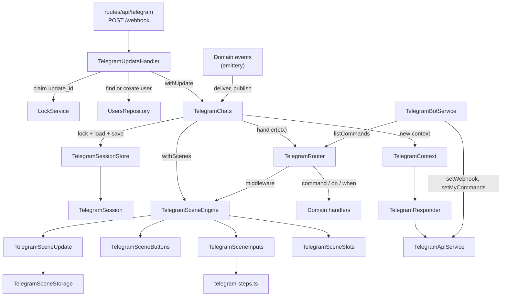
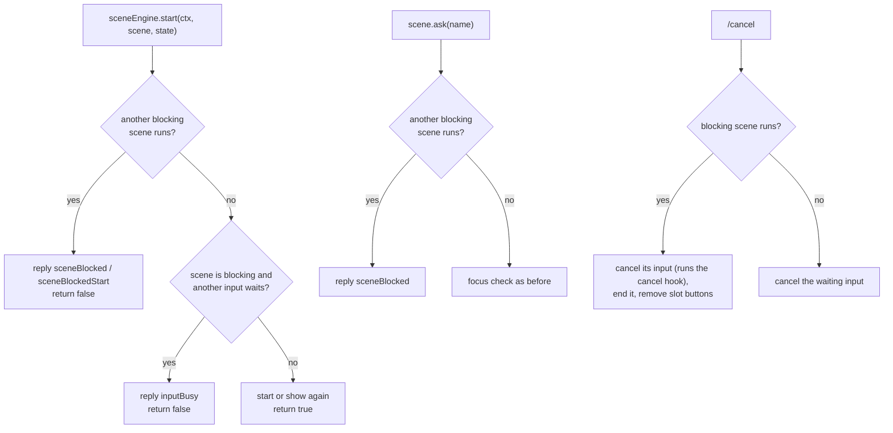
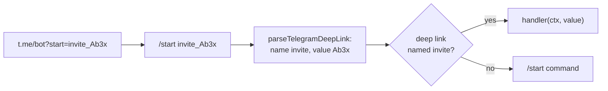

# Telegram

This directory is the Telegram transport and the scene engine of the bot. It turns a webhook request into a call of a command, a route or a scene, keeps the per-user state in Valkey, and draws the scene messages. It does not import feature domains: a domain registers its commands and scenes through `TelegramRouter`.

The root `AGENTS.md` says how to write a scene. This file explains how each mechanism works inside and which problem it solves. Every mechanism follows the same shape: the problem, the idea, the data it keeps, a walk-through, and the edge cases.

- [What Telegram gives us](#what-telegram-gives-us)
- [Map](#map)
- [An incoming update](#an-incoming-update)
- [Session and lock](#session-and-lock)
- [Scene instances](#scene-instances)
- [Buttons](#buttons)
- [Slots](#slots)
- [Inputs](#inputs)
- [Blocking scenes](#blocking-scenes)
- [Updates for other users](#updates-for-other-users)
- [Deep links](#deep-links)
- [Access and the command menu](#access-and-the-command-menu)
- [Files](#files)

## What Telegram gives us

Most of the code below exists because of these limits of the Bot API:

- The webhook can deliver several updates of one user at the same time, and it sends an update again when the bot does not answer `2xx`.
- A message does not say which question it answers. The bot gets free text and must decide itself where it goes.
- `callback_data` of an inline button holds 1 to 64 bytes. A press brings back only this string and the id of the message with the button.
- Old messages with buttons stay in the chat. The user can press a button of a message that the bot drew an hour ago.
- The bot changes a message only by its id. An edit to the same content fails with `message is not modified`, and a text message cannot become a photo.
- The bot can delete its own message only during 48 hours after it sent it.
- A link into the bot can only send `/start <payload>`, with at most 64 characters of `A-Z`, `a-z`, `0-9`, `_` and `-`.
- The command menu is set per chat and per language with `setMyCommands`. A command name holds only `a-z`, `0-9` and `_`, at most 32 characters.

## Map



## An incoming update


**Duplicates.** Before anything else, the handler sets `telegram:update:<update_id>` with `SET NX` for 24 hours. A second delivery of the same update finds the key and ends as `duplicate`. The claim stays after a failure too, so a failed update never runs twice.

**Errors.** `TelegramUpdateHandler` turns every expected failure into a typed error from `telegram-errors.ts` and a result label of `telegram_updates_total`. A failed Bot API call throws `TelegramApiError` with the method, `error_code`, description and `retry_after`. The handler labels a 403, a user who blocked the bot, as `blocked` and a 429 as `rate_limited`, and sends no error reply for them, because that reply would fail the same way. An unexpected error is logged and gets the `telegram:error` reply. For a request with a valid secret token the route always answers `200`, so Telegram does not send an update again after it failed in the bot.

## Session and lock

**Problem.** A scene keeps its state between updates, so the state must live outside the process. Two updates of one user can run at the same time on two pods. When both read a scene, change it and write it back, the second write loses the change of the first one.

**Idea.** Every user has one session in Valkey, and only the holder of the session lock reads and writes it. An update collects its changes in memory and writes all of them in one atomic call, and only while it still holds the lock.

**Data.**

```text
telegram:session:42            hash, every field with its own TTL (HPEXPIRE)
    scene:Xk3f9aB1c0dE         the record of one scene instance, JSON
    focus                      id of the scene whose input waits for text
    blocking                   id of the running blocking scene
telegram:session:42:lock       token of the update that holds the session
telegram:index:<name>          sorted sets, see "Updates for other users"
```

A hash keeps all the state of a user under one key, so one Lua call writes it atomically. A field TTL lets every scene expire on its own, without a cleanup job. `HPEXPIRE` needs Valkey 9.

**Walk-through.**

1. `TelegramSessionStore.withSession` takes the lock: `SET <session>:lock <token> NX PX 30000`. It tries again every 50 ms and gives up after 10 s with `LockTimeoutError`. A wait of more than 1 s logs a warning; `lock_wait_seconds` measures every wait.
2. While the update runs, the lock extends itself every 10 s, so a long update does not lose it.
3. `TelegramSession.read` loads a field the first time somebody asks for it and keeps it in memory. A handler that touches one scene reads one field.
4. `write`, `remove`, `index` and `unindex` only record the change.
5. At the end, `save` sends every change in one Lua script. The script first compares the lock key with the token of this update. When it differs, the script writes nothing and the update fails with `LockLostError`. Otherwise it runs `HSET` and `HPEXPIRE` for every written field, `HDEL` for every removed field, and updates the index sets.
6. The lock is released with a `DEL` under the same token check.

**Edge cases.** The session is saved also when the handler throws, so the changes made before the error stay. When the save fails too, the update throws an `AggregateError` with both errors. A pod that stops for longer than the lock TTL loses the lock, and its later save writes nothing. Every write with the bot's own context goes through this lock, also an update for another user, so a delivery and the user's own update never mix.

## Scene instances

**Problem.** A handler needs a typed state that lives between updates and goes away on its own. A user can have several such states at once, and some of them must exist only once per business entity.

**Idea.** `defineScene` describes a scene. An instance of it is one record in the session, with its own id and TTL. The engine finds the instance again by the id that comes back in a button press or in the `focus` field.

**Data.** One field `scene:<sceneId>` per instance:

```json
{
    "name": "invites",
    "startedAt": 1760500000000,
    "state": { "screen": "invite", "inviteId": "66f1c2…", "page": 0 },
    "buttons": { "nextId": 7, "messages": [] },
    "slots": {
        "invites": { "messageId": 812, "kind": "text", "hash": "Qm9…" }
    },
    "topics": ["invites.invite:66f1c2…"]
}
```

**Walk-through.**

1. `sceneEngine.start(ctx, scene, state)` checks the guard of the scene and builds the id. With a `key`, the id is the first 12 characters of `sha256("<scene name>:<key>")` in base64url, so the same key always gives the same id. Without a `key`, the id is 8 random bytes.
2. When a record with this id already exists, `start` does not create a second one. It shows the running scene again: its slot messages move to the bottom of the chat, and the state stays as it is.
3. Otherwise the engine creates the record and runs the `start` hook of the scene.
4. Every call that gives a handler the scene object marks the instance as touched in `TelegramSceneUpdate`.
5. After the update, the engine draws the slots of the touched instances, but only when the handler succeeded. It saves the touched instances always.
6. `save` writes the record with a TTL of `min(ttl, startedAt + maxAge - now)`. So `ttl` is the idle time after the last touch, and `maxAge` is the limit from the start. When that value reaches 0, `save` removes the record.

**Edge cases.** The engine reads a record through the current TypeBox schema of the scene. After a deploy that removed the scene or changed the schema of its state, the record does not match. The engine then removes the record and logs `Telegram scene is not registered or its state is outdated`. The user's next press on its buttons gets `buttonExpired`. Business data stays in the domain repository. The state keeps only the view of it, such as an id and a page, so a lost record loses nothing important.

## Buttons

**Problem.** A button must bring the scene, the action and its value back to the bot. `callback_data` holds only 64 bytes, which is too small for an `ObjectId`, an action and a draft. And the user can press a button on an old message after the scene drew a new version of that message.

**Idea.** The value of a button stays in the scene record. `callback_data` is only a reference, `<sceneId>:<buttonId>`, and the record keeps the buttons of each message separately.

**Data.** `buttons` in the scene record:

```json
{
    "nextId": 7,
    "messages": [
        {
            "messageId": 812,
            "buttons": {
                "3": { "kind": "scene", "name": "open", "value": "66f1c2…" },
                "4": { "kind": "scene", "name": "page", "value": 1 }
            }
        }
    ]
}
```

A `scene` button runs a handler from `buttons` of the scene. An `input` button belongs to one step of an input, see [Inputs](#inputs).

**Walk-through.**

1. A slot or a handler calls `scene.button("Open", "open", id)`. The engine looks for an equal button, the same name and value, in the message that the slot shows now. When it finds one, it takes its id. Otherwise it takes `nextId` and increments it.
2. The engine keeps the button in memory as unsent and returns `{ text, callback_data: "Xk3f9aB1c0dE:3" }`.
3. `TelegramContext` sends or edits the message and emits `messageSent` or `messageEdited` with the keyboard.
4. The engine reads the `callback_data` of this scene from the keyboard and writes only those buttons under the id of the message. A button that never reached a message is never stored.
5. A press with `Xk3f9aB1c0dE:3` on message 812 loads the instance `Xk3f9aB1c0dE` and finds button 3 in message 812.
6. The engine checks the value against the schema of the `open` button and checks the guard of the scene and of the button. Then it runs the handler with the stored value.

**Why the id is reused.** The slot compares a hash of its content, and the content includes the `callback_data`. When a redraw gives an equal button a new id, the hash changes and the engine calls `editMessageText` for a message that looks the same. With the old id, an unchanged screen costs no API call.

**Edge cases.**

- A message that the scene edited without a button, or deleted, no longer holds that button. A press on it, or on a message of an ended scene, gets `telegram:buttonExpired`.
- A value that no longer matches the schema of its button after a deploy also gets `buttonExpired`. A failed guard gets `telegram:forbidden`.
- A press does not need the input focus, so the buttons of every running scene work at the same time.

## Slots

**Problem.** A scene often shows its state as one message that changes: a list with pages, a form. Without help, every handler would keep the message id, choose between send and edit, avoid `message is not modified`, and clean up after a deleted message.

**Idea.** A slot is a function of the state that returns the content of a message. The handler only changes the state. After the update, the engine renders every slot of every touched instance and brings the message in line with it.

**Data.** `slots` in the scene record keeps, per slot name, the id of the message, its kind (`text`, `rich` or `media`) and a SHA-256 hash of the content that it shows now.

**Walk-through.** For every slot of a touched instance, after the handler succeeded:

1. The engine calls the slot and gets the content, or `undefined`.
2. With `undefined`, it deletes the old message and forgets the slot.
3. With the same hash as before, it does nothing.
4. Otherwise it edits the old message. `message is not modified` counts as a success.
5. When the edit is not possible or fails, for example because the user deleted the message, it deletes the old message and sends a new one. A `media` message is never edited into text; a text message is edited into media only when Telegram accepts it.

A second `start` of a running scene sets `reshow`: the engine skips the hash check and sends the slot again as a new message at the bottom of the chat. Messages that a handler sends with `ctx.reply` come before the slot messages, because the slots render at the end.

**Edge cases.** When the handler fails, the state is saved but the slot is not drawn. The next touch of the scene finds a different hash and draws it. When the bot cannot delete a message, for example one older than 48 hours, it removes the keyboard of the message instead. `scene.end({ messages })` chooses what happens to the slot messages: `keep`, `removeButtons` or `delete`.

## Inputs

**Problem.** A typed message has no reference to a scene. When two scenes wait for text at the same time, the bot cannot know which one the text answers.

**Idea.** Only one input of a user waits for text at a time. The `focus` field of the session points to the scene that holds it. An input is a list of steps with a typed payload, and each step decides which updates it accepts.

**Data.** `input` in the scene record, and `focus` in the session with the same TTL as the scene:

```json
{
    "name": "maxUses",
    "step": "value",
    "history": [],
    "payload": {},
    "messageIds": [901, 902]
}
```

**Walk-through.**

1. A handler calls `scene.ask("maxUses")`. The engine checks the guard of the scene and of the input, and that no other scene holds the focus. Then it writes `input` and runs `enter` of the first step, which usually sends the question.
2. The engine runs as a middleware before the routes. For a message, it loads the instance from `focus`.
3. When the current step `accepts` the update, the step runs `handle` and returns a transition: `next`, `stay`, `goto`, `back`, `cancel` or `complete`. A transition can carry a `patch` for the payload, and `back` follows `history`.
4. After the last step, or on `complete`, the engine decodes the payload with its schema, removes `input` and calls `complete` of the input.
5. A text message that the step does not accept gets the `hint` of the step. A command is never input text: `message("text")` skips commands, so `/cancel` and every other command still reach the routes.

**Edge cases.**

- `cleanup: true` collects the ids of the user's answers and of the bot's messages during a step, and deletes them when the step ends.
- A step that throws drops the whole input and its buttons. The scene stays.
- A second `ask` in the same scene replaces its input. An `ask` while another scene holds the focus gets `telegram:inputBusy`.
- `focus` repairs itself. When it points to a scene that has no input any more, or to an input that a deploy removed, the engine clears it.
- An `input` button is valid only while its step is the current step. Every step change forgets the input buttons of the scene.

## Blocking scenes

**Problem.** Some flows, such as a wizard, must finish before the user starts anything else.

**Idea.** A scene with `blocking: true` writes its id into the `blocking` field of the session, which expires with the scene. While the field points to a running scene, the engine refuses every other scene start and every other input.



**Edge cases.** Buttons of other running scenes keep working, because their `callback_data` names the scene. A button handler that starts a scene still gets `false`, and its `scene.ask` gets a refusal. A blocking scene without a `key` gets a random id, so `start` takes the id of the running blocking scene of the same definition and shows it again.

## Updates for other users

**Problem.** Some data belongs to several users at once, such as an invite that every admin can open. Every user who looks at it has their own scene instance. When one user changes the data, the scenes of the other users must redraw. A handler cannot write to their sessions: each session belongs to the holder of its lock.

**Idea.** The change goes through a domain event. The domain plugin then asks `TelegramChats` to run code inside each affected chat, under that user's lock, as if the user had sent an update. The engine renders and saves the scenes there in the usual way.

There are two ways to find the affected scenes.

### Publish to the scenes that watch a topic

A topic is a name of the data that a scene shows, chosen by the domain and prefixed with it, such as `invites` or `invites.invite:<id>`. A scene declares the topics it shows now with `watch(state)`, so the topics follow the state. The domain does not need to know who looks at the data: it calls `telegramChats.publish(topics)` after the change.

**Data.**

```text
telegram:index:scene-topic:invites.invite:66f1c2…     sorted set
    42:invites:Xk3f9aB1c0dE      score 1760586400000   (expiry of the scene)
    77:invites:Pq81LmZ0aa2K      score 1760590000000
```


**Walk-through of the index.**

1. On every save, `TelegramSceneStorage` calls `watch` on the state. It adds the instance to the set of every topic, with the expiry time of the scene as the score. It removes the instance from the topics that it no longer watches. `record.topics` remembers the last list.
2. Ending a scene, or dropping an outdated record, removes it from all its topics.
3. The sets change in the same Lua call as the session hash, under the same lock check, so the index and the records cannot disagree after a save.
4. A read skips members whose score has passed. Every write to a set removes them and moves the expiry of the set to its last member, so the set disappears with its last scene.
5. Under the lock of the user, `redraw` loads the record again and checks that it still watches one of the topics and that its guard still allows the user. The index can be one step behind; the record decides.

A redraw from `publish` saves the scene, so it extends the TTL of the scene like a button press.

### Deliver to known users


`targets` pairs every user id with the scene key, which is the entity id. Use `deliver` when the domain knows the users, such as the players of a table, or when the scene must change its state or send a notification. Without `handle` the scene only redraws its slots from the repository. With `handle` it can also change its state or send a notification.

**Edge cases for both.** `publish` and `deliver` return at once, so `emit` never waits for the sessions of other users. A failure for one user does not stop the others: it logs `Failed to publish a scene update` or `Failed to deliver a scene update` and counts `delivery_failed`. `telegramChats.idle()` waits for every pending run; tests call it, and the server calls it on close. `eventEmitter` is in-process, but the sessions, the index and the locks are in Valkey, so a publish on one pod redraws the scenes of users whose updates go to another pod.

## Deep links

**Problem.** A link into the bot can only send `/start <payload>`, and several domains need their own links.

**Idea.** The payload names its handler: `<name>_<value>`, where the name is `a-z0-9` and the value is everything after the first `_`, such as `invite_Ab3x_9-k`.



A domain registers its link with `router.deepLink(name, handler, options)`; a name is registered once, like a command. `TelegramBotService.resolveDeepLinkUrl({ name, value })` builds the URL and throws when the payload does not fit Telegram's limits, so the format lives in `telegram-deep-links.ts` and nowhere else. A payload without a known name falls through to the `/start` command. A banned user gets only the links registered with `allowBanned`.

## Access and the command menu

A guard is a `(user) => boolean` from `telegram-guard.ts`. The transport knows only this type; a domain builds the guard from its CASL rules with `access.guard(action, subject)` on its typed view of the access service. The engine checks the guard at every place where the user acts, so a user who loses a grant loses the running scenes at once, without a cleanup.

| Guard on              | Checked                                            | When the guard refuses                                                          |
| --------------------- | -------------------------------------------------- | ------------------------------------------------------------------------------- |
| command, `on`, `when` | while the router looks for a route                 | the route does not match, the user gets `unknown`                               |
| deep link             | while the router looks for a route                 | the `/start` command answers                                                    |
| scene                 | `start`, button press, input, `deliver`, `publish` | `start` returns `false`, a press gets `forbidden`, `deliver` and `publish` skip |
| scene button          | button press                                       | the callback gets `forbidden`, the handler does not run                         |
| scene input           | `ask`, input text, input button                    | `ask` replies `forbidden`, the text goes to the routes                          |

`isBanned` is not a guard: it is the gate before the router. A banned user gets only the deep links registered with `allowBanned`, such as an invite link.

**The command menu.** The guards of the commands also build the menu of each chat, so a user sees only the commands the user can run.

1. `TelegramBotService.syncCommands` runs on every update of a user with access, and on `users.accessChanged`, which `UsersService` emits after it changes the grants of a user.
2. It lists the commands whose guard allows the user, in the user's language, and hashes the list together with the menu generation from `telegram:commands:generation`.
3. When the hash equals `telegram:commands:<telegramId>`, it does nothing. Otherwise it calls `setMyCommands` with the chat scope and stores the new hash for 30 days.

So the menu changes after a new grant, a language change, or a deploy that adds a command, and costs no API call otherwise. A failed sync logs an error and does not fail the update.

**Production and preview.** On start, production sets the webhook once per hour across pods and sets the default menu: the commands without a guard, in every language. Preview pods share one bot token, so they do neither on start. `POST /api/telegram/webhook/refresh` points the webhook at the preview, sets the default menu and writes a new generation. The new generation changes every hash, so each chat gets its menu again on its next update.

## Files

| File                                                               | Owns                                                                 | Section                                                     |
| ------------------------------------------------------------------ | -------------------------------------------------------------------- | ----------------------------------------------------------- |
| `telegram-update-handler.ts`                                       | One webhook update from start to end                                 | [An incoming update](#an-incoming-update)                   |
| `telegram-chats.ts`                                                | Running code inside one user's chat: an update, `publish`, `deliver` | [Updates for other users](#updates-for-other-users)         |
| `telegram-session-store.ts`, `telegram-session.ts`                 | The session hash, its lock and the indexes                           | [Session and lock](#session-and-lock)                       |
| `telegram-context.ts`                                              | What a handler can do in the chat; emits the message events          | [Buttons](#buttons)                                         |
| `telegram-responder.ts`                                            | Bot API calls for one chat, also before a context exists             | [Slots](#slots)                                             |
| `telegram-api-service.ts`                                          | HTTP calls to the Bot API with a timeout, logs and metrics           |                                                             |
| `telegram-router.ts`                                               | Commands, deep links, filters, middlewares                           | [Access and the command menu](#access-and-the-command-menu) |
| `telegram-deep-links.ts`                                           | The deep link payload                                                | [Deep links](#deep-links)                                   |
| `telegram-guard.ts`                                                | The guard type                                                       | [Access and the command menu](#access-and-the-command-menu) |
| `telegram-scene.ts`                                                | `defineScene` and the transitions of a step                          | [Scene instances](#scene-instances)                         |
| `telegram-scene-engine.ts`                                         | Start, find and end instances; route presses and input text          | [Scene instances](#scene-instances)                         |
| `telegram-scene-storage.ts`                                        | Scene records, ids, `focus`, `blocking`, TTL, topics                 | [Scene instances](#scene-instances)                         |
| `telegram-scene-update.ts`                                         | The instances one update touched; renders and saves them             | [Scene instances](#scene-instances)                         |
| `telegram-scene-buttons.ts`                                        | Button values per message                                            | [Buttons](#buttons)                                         |
| `telegram-scene-slots.ts`                                          | Messages that mirror the state                                       | [Slots](#slots)                                             |
| `telegram-scene-inputs.ts`                                         | Named inputs and their steps                                         | [Inputs](#inputs)                                           |
| `telegram-steps.ts`                                                | `textStep`, `numberStep`, `dateStep`, `choiceStep`                   | [Inputs](#inputs)                                           |
| `telegram-pagination.ts`                                           | `pageOf` and the `‹ 1/3 ›` row of `pageButtons`                      |                                                             |
| `telegram-system-handlers.ts`                                      | `/start` and `/cancel`                                               | [Blocking scenes](#blocking-scenes)                         |
| `telegram-bot-service.ts`                                          | The webhook, the command menus, the bot username, deep link URLs     | [Access and the command menu](#access-and-the-command-menu) |
| `telegram-filters.ts`, `telegram-extractors.ts`                    | Type guards and readers of an `Update`                               |                                                             |
| `telegram-parsers.ts`, `telegram-html.ts`                          | Parsers of typed input; HTML helpers for messages                    |                                                             |
| `telegram-metrics.ts`, `telegram-errors.ts`, `telegram-locales.ts` | Metrics, error types, texts                                          |                                                             |

To read the code in order:

1. `telegram-update-handler.ts`, `handle()`: the whole path of an update.
2. `telegram-chats.ts`, `withContext()`: how a context and the scenes get their session.
3. `telegram-scene-engine.ts`, `handle()` and `withScenes()`: how scenes get updates and when they are saved and drawn.
4. `telegram-chats.test.ts` and `telegram-scene-engine.test.ts`: small complete scenes that show the API in use.
